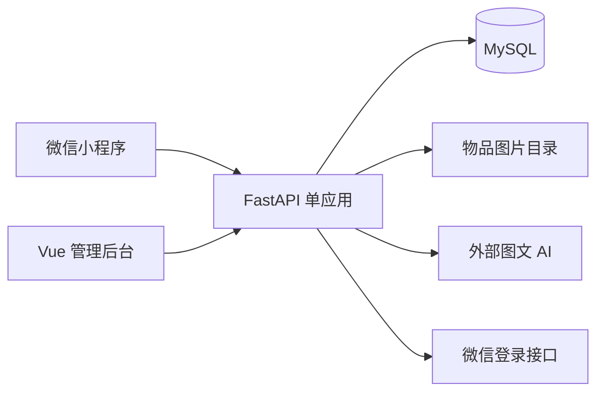

# Python 版总体架构

本项目采用 **原生微信小程序 + FastAPI 后端 + MySQL + Vue 管理后台**。四人共同完成一个应用，保持六张表、七个小程序页面、32 个业务 HTTP 接口。

这是开发设计与目录骨架，尚未实现可运行系统。课程资料仍在项目外的 CourseDocument。

## 1. 技术选择

| 部分 | 选用 | 原因与边界 |
|---|---|---|
| 小程序 | TypeScript、WXML、WXSS | A 统一维护七个页面，后端语言变化不影响页面 |
| 后端 | Python 3.12、FastAPI、Uvicorn | 路由按模块组织，自动生成联调文档 |
| 数据校验 | Pydantic 2、pydantic-settings | 请求/响应校验、环境变量加载 |
| 数据库 | MySQL 8 系列、SQLAlchemy 2、PyMySQL | 同步数据库访问，保留事务和行锁 |
| 外部请求 | HTTPX 同步客户端 | 调用微信登录和一个图文模型 |
| 图片 | 本地持久目录、Pillow 校验 | JPEG/PNG，每张最多 5MiB |
| 管理端 | Vue 3、Vite、TypeScript | 登录、信息管理、举报管理三页 |
| 测试 | pytest、FastAPI TestClient、真实 MySQL | 规则单测、接口与事务验证 |

以上是选定的版本系列，不声称是最新版本。D 初始化时解析兼容依赖，将实际通过的精确版本固定到 requirements.txt 和 requirements-dev.txt，所有人使用同一套。先不引入 Redis、Celery、向量库或微服务。

选 FastAPI 是为了让本课设以 API 和模块开发为主，直接对接小程序；这是本项目的取舍。第一版统一使用同步 Session 和普通 def 路由。同步数据库/HTTP 不直接放进 async def；不混用 AsyncSession、异步驱动或跨请求共享 Session。

## 2. 系统结构



推荐按规则计算，不调用模型。模型仅在用户点击“AI 帮我填写”时调用，失败后可以继续手填。

## 3. 三层职责

| 层/文件 | 职责 |
|---|---|
| routers/ | HTTP 参数、身份依赖、开启业务事务、调用 service、返回响应 |
| services/ | 业务规则、权限、跨模块协作，不自行 commit |
| repositories.py | 本模块数据库读写，包含必要的行锁 |
| models.py | SQLAlchemy 表映射 |
| schemas.py | Pydantic 请求/响应和模块对接数据 |

C 没有自有数据库表，不建 models.py 或 repositories.py。规则计算单独放 rules.py，模型请求放 provider.py，不增设大型抽象框架。

```text
backend/
├── app/
│   ├── main.py                    D：应用、路由注册
│   ├── common/                    D：配置、数据库、返回、异常
│   ├── business/                  B：信息、申请、线索、只读查询
│   ├── intelligence/              C：AI、规则推荐
│   └── platform/                  D：身份、文件、字典、举报、管理
├── sql/                           B/D：建表和演示数据
└── tests/                         分模块 pytest
```

具体文件清单见 [分工](docs/02-modules-and-team.md)。这些拟建 Python 文件不代表已实现。

## 4. 模块依赖与循环导入

| 调用 | 用途 |
|---|---|
| business/services/posts.py → platform/services/files.py | 校验、绑定图片 |
| platform/services/files.py → business/queries.py | 检查关联信息的可见性 |
| intelligence/services/matching.py → business/queries.py | 读取源信息和候选 |
| intelligence/services/extract.py → platform/services/files.py | 读取本人图片 |
| platform/routers/admin.py → business/services/posts.py | 下架并结束申请 |

business/queries.py 仅依赖本模块 models/schemas/repositories 及 common，不导入写服务、文件服务或路由。各模块不得从 main.py 导入 app；仅 main.py 汇总 routers。依赖按具体文件导入，__init__.py 保持简单，不集中重导出所有服务。

平台与业务有协作，但按文件组织后不构成循环导入。不要用延迟导入掩盖结构问题。

## 5. Python 事务约定

- common/database.py 统一 Engine、Session 工厂和 ORM Base。
- 一个请求的业务操作使用一个 Session，不放全局 Session，不跨线程或请求复用。
- 写路由拿到未执行查询的新 Session，先进入 with session.begin()，再做业务查询与修改。
- service/repository 接收同一个 session，只能 flush，不 commit/rollback；路由正常退出提交，异常回滚。
- 认证依赖用独立短 Session 读取账号，关闭后返回普通 CurrentUser 数据，不返回 ORM 用户对象。因此不会提前开启业务 Session 的隐式事务。
- 接受、取消、完成、下架等先锁 post，再检查/更新 claim；使用 with_for_update()，在真实 MySQL 验证。
- 上传校验和磁盘写入放在短数据库事务外；保存附件记录失败时清理本次文件。编辑关联在帖子事务内更新。
- AI 先读所需信息和图片元数据，结束读取 Session，再调用模型；网络等待不持有数据库事务。

不新增事务框架。内部方法输入与样例见 [开发交接](docs/06-development-and-testing.md)。

## 6. API 与身份

保持 /api/v1、camelCase JSON、字符串 ID 和现有 32 个接口。Python 内部用 snake_case 和 int ID，通过 schemas.py 显式转为外部响应。

使用 platform/dependencies.py 的 optional_user、require_user、require_admin 注入身份。公开 GET 可带有效 token 识别本人历史；写接口必须 require_user，管理员接口必须 require_admin。不使用放行整段 /posts/** 的粗粒度规则。

Pydantic 校验错误统一转换为 HTTP 400 / INVALID_ARGUMENT，不能把 FastAPI 默认 422 直接混入现有契约。文件内容接口直接返回图片，不套 JSON。

开发环境可用 FastAPI 自动生成的 /docs 和 /openapi.json；它们是工具端点，不计入 32 个业务接口。文档中的请求、响应和权限是联调依据，不另手写一套大型 OpenAPI。

## 7. 功能边界与启动条件

保留 AI 图文辅助、规则推荐、文字线索、认领交接、举报管理。不自动关联寻物与认领，没有消息中心或证明图片。

能运行的前提：先建立 requirements、main.py、配置、六表脚本、小程序工程、管理员初始化方式和真实外部服务配置。独立开发前先提交公共骨架和内部类型，再用模拟数据并行开发，尽早接通一条业务流程。

## 8. 官方实现参考

- [FastAPI 多文件路由](https://fastapi.tiangolo.com/tutorial/bigger-applications/)
- [FastAPI 同步与异步处理](https://fastapi.tiangolo.com/async/)
- [SQLAlchemy Session 与事务](https://docs.sqlalchemy.org/en/20/orm/session_basics.html)
- [Pydantic 字段别名](https://pydantic.dev/docs/validation/latest/concepts/alias/)

这些资料用于核对框架行为，本项目的功能和目录以当前六份文档为准。
