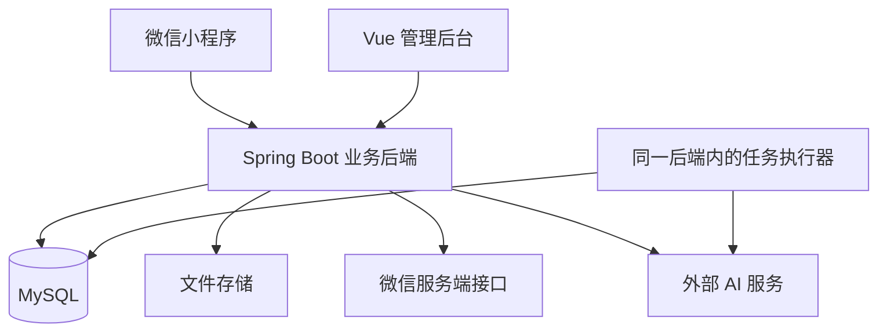

# 总体架构

本文件说明系统怎样分工、分层和运行。字段、接口与页面细节分别在专门文档中维护。

**确定方案：原生小程序 + 模块化单体后端 + 持久化 AI 任务 + 规则与语义混合推荐。**

阅读前可先看 [项目概览](docs/00-project-overview.md)；技术名词见 [术语说明](docs/10-glossary.md)。

审查修订、机器合同与运行关卡见 [设计审查](docs/13-design-review.md)。本轮只证明文档结构与设计约定一致，尚无运行时验证。

## 1. 系统由哪些部分组成



小程序负责学生交互，后台负责管理，业务后端统一处理权限、数据、认领与模型调用。后台任务执行器仍属于同一个后端应用。

### 技术选择

| 部分 | 第一版方案 | 为什么这样做 |
|---|---|---|
| 学生端 | 原生小程序，TypeScript、WXML、WXSS | 直接使用页面、媒体和网络能力 |
| 管理端 | Vue、TypeScript | 管理流程与学生界面独立 |
| 后端 | Java 21、Spring Boot | 一个应用内部按业务模块开发 |
| 数据访问 | MyBatis、MySQL、Flyway | 明确 SQL、事务与版本化迁移 |
| 身份 | Spring Security、平台随机 token | 统一鉴权，支持撤销会话 |
| 文件 | 后端文件服务、服务器持久化目录 | 实现简单，保留切换存储的接口 |
| AI | 外部图文理解和文本向量服务 | 无需训练和 GPU |
| 异步处理 | 数据库任务表、调度器、有界线程池 | 支持重启恢复，限制调用并发 |

第一版按单校园、一个后端实例和课设数据量设计。依赖精确版本、模型服务与配额在真实环境验证后锁定。

## 2. 小程序与后端分别怎样分层

### 小程序

```text
页面与组件
    ↓ 调用
业务 services
    ↓ 调用
request / upload / auth / job-poller
    ↓
后端 API
```

页面处理交互，services 封装业务接口，工具处理网络、上传、登录和轮询。业务规则和权限最终由后端决定。

### 后端

每个业务模块都按下面四层组织：

| 层 | 负责什么 | 不应承担什么 |
|---|---|---|
| API 层 | 接收请求、检查参数、返回 DTO | 不直接写 SQL 或调模型 |
| 应用层 | 组织用例、权限、事务和跨模块步骤 | 不持有长时间模型事务 |
| 领域层 | 状态转换、约束和评分规则 | 不依赖微信或模型 SDK |
| 基础设施层 | 数据库、文件和外部服务适配 | 不决定业务归属 |

普通 CRUD 不必层层增加无意义接口。对模型、微信和文件等外部能力保留可替换的适配接口。

## 3. 模块边界与数据归属

A 统一维护整个小程序。后端按维护区域建目录：`modules/business/` 归 B，`modules/intelligence/` 归 C，`modules/platform/` 和 `common/` 归 D。管理端与部署也归 D。

每个区域下保留业务模块，每个模块内部仍分四层。这是代码组织，不新增部署服务。

B 通过 C 的 JobService 落库入队；C 通过 B 的只读 PostQueryService 取候选。JobService 不依赖处理器，查询服务不依赖入队，避免服务循环注入。

| 模块 | 主要职责 | 负责人 |
|---|---|---|
| identity | 用户、登录会话、角色和账号状态 | D |
| post | 寻物招领、正式特征、图片关联、信息状态 | B |
| ai | 提取草稿、模型调用、文本向量 | C |
| matching | 候选筛选、评分、双向匹配结果 | C |
| recovery | 线索、认领、交接和归还流程 | B |
| notification | 站内通知、已读和去重 | B |
| asset | 文件上传、归属和受控读取 | D |
| moderation | 举报、下架、字典和统计管理 | D |
| job | 任务入队、领取、租约与恢复 | C |

**正式物品特征归 post，AI 建议归 ai。** 用户确认前，模型输出不能成为正式数据。

模块之间通过应用服务协作，不直接修改其他模块的数据表。B 统一维护信息和申请状态，C 统一维护 AI 和任务。具体交接见 [模块与分工](docs/02-modules-and-team.md)。

## 4. 三条关键运行流程

### 4.1 AI 辅助发布

```text
用户输入文字或照片
    → 创建提取任务
    → 模型生成草稿
    → 用户确认或修改
    → 正式发布
```

AI 失败时，保留已输入内容，允许手动发布。

### 4.2 发布后的匹配

```text
同一事务保存：信息 + 特征 + 附件关联 + 匹配任务
    → 返回发布成功
    → 后台准备向量、筛选候选、排序
    → 保存结果并创建站内通知
```

图片先转为用户确认的文字特征，再参与匹配。因此失主没有照片也可使用。第一版不做独立图像向量检索。

### 4.3 认领与归还

```text
提交私密证明 → 拾取者接受 → 双方交接 → 确认归还
```

接受申请时，申请和招领状态在同一事务内更新。同一招领最多接受一个申请。

归还时，同时结束招领、申请、其他待处理申请，并校验后结束关联寻物信息。

## 5. 小程序的实现边界

- 微信登录只建立平台身份，不证明学生身份。
- AppSecret、session_key 和模型密钥仅放服务端。
- tabBar 页面放主包；普通分包复用主包组件。
- 小程序隐藏时停止轮询，回前台再查已有任务。
- 临时图片路径只用于本地预览，上传后用 fileId。
- 校园地点先用字典选择，不要求 GPS。
- 站内消息必做，微信订阅消息按账号能力选做。

登录流程、图片处理和生命周期见 [小程序设计](docs/05-miniprogram.md)。

## 6. 可靠性与权限的关键约定

| 风险 | 设计 |
|---|---|
| 模型耗时长 | 异步任务，发布不等待匹配完成 |
| 进程重启 | 任务落库，租约到期可恢复 |
| 重复执行 | 幂等结果、唯一键、通知去重 |
| 旧任务晚到 | 校验双方内容版本，过时结果不生效 |
| 语义服务失败 | 返回规则推荐，明确标记模式 |
| 多人同时被接受 | 父信息加锁或条件更新，事务校验 |
| 证明泄漏 | 私密附件鉴权后签发短期访问地址 |
| 信息已下架 | 查询即时检查可见状态，不等异步清理 |

外部模型请求不占用数据库长事务。任务执行允许至少一次，不能承诺外部服务绝不重复计费。

## 7. 第一版边界与演进

第一版不做聊天、支付、导航、学生实名认证、自动认领审批、自训练模型和微服务拆分。

| 何时考虑扩展 | 可以怎么改 |
|---|---|
| 候选计算实测变慢 | 增加检索索引或向量检索服务 |
| AI 任务影响普通请求 | 独立部署 worker，沿用任务合同 |
| 多实例需要共享文件 | 切换到对象存储 |
| 图片转文字明显影响效果 | 再评估图像或跨模态向量 |
| 通知模板和授权可用 | 增加微信订阅消息 |

以上都不作为第一版开工条件。

## 8. 开工前先证明可行

先验证真机登录、上传与私密图片展示、真实模型调用，以及任务重启恢复。然后完成规则业务闭环，再接语义增强。

- 字段与事务：[数据库设计](docs/03-database.md)。
- 前后端交换数据：[接口说明](docs/04-api-contracts.md)。
- 模型、评分与恢复：[AI 与匹配](docs/06-ai-and-matching.md)。
- 开发顺序：[实施计划](docs/09-implementation-plan.md)。

## 9. 官方参考

这些链接支持框架能力与限制；模块、任务和评分方案是本项目的设计选择。

- [微信登录](https://developers.weixin.qq.com/miniprogram/dev/framework/open-ability/login.html)
- [微信网络](https://developers.weixin.qq.com/miniprogram/dev/framework/ability/network.html)
- [选择媒体](https://developers.weixin.qq.com/miniprogram/dev/api/media/video/wx.chooseMedia.html)
- [上传文件](https://developers.weixin.qq.com/miniprogram/dev/api/network/upload/wx.uploadFile.html)
- [订阅消息](https://developers.weixin.qq.com/miniprogram/dev/api/open-api/subscribe-message/wx.requestSubscribeMessage.html)
- [分包加载](https://developers.weixin.qq.com/miniprogram/dev/framework/subpackages/basic.html)
- [Spring 任务执行与调度](https://docs.spring.io/spring-framework/reference/integration/scheduling.html)
- [Spring 事务绑定事件](https://docs.spring.io/spring-framework/reference/data-access/transaction/event.html)
