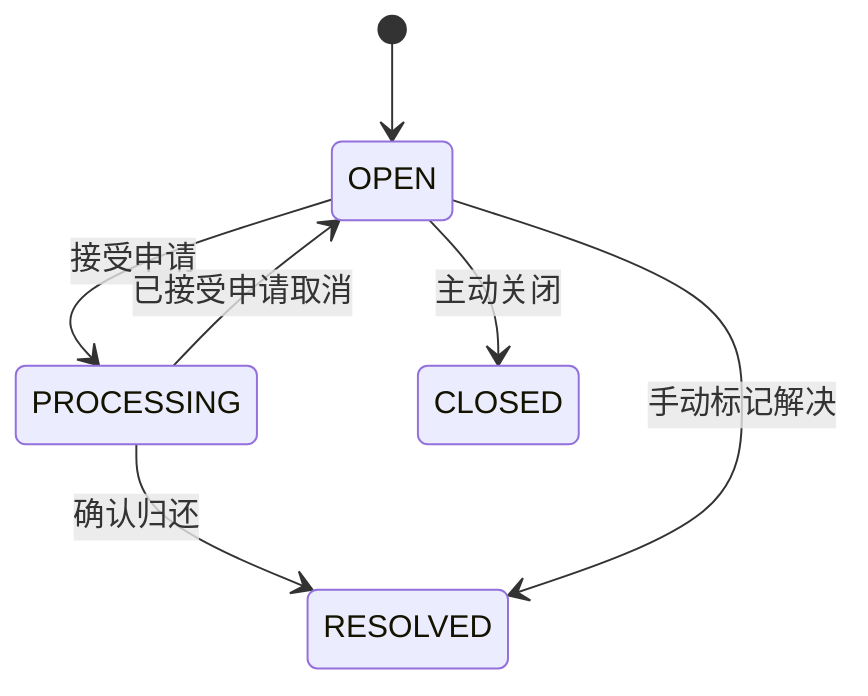

# 需求规格

本文件确定第一版“做什么”和“怎样才算做对”。业务规则以本文件为准，接口字段见 [接口说明](04-api-contracts.md)。

## 1. 用户与主流程

| 角色 | 权限 |
|---|---|
| 访客 | 浏览、搜索正常公开的信息 |
| 登录用户 | 发布、提供线索、申请认领、处理自己的信息 |
| 管理员 | 处理举报、管理信息和用户、维护字典 |

失主、拾取者和线索提供者是业务身份，同一用户可以在不同事件中担任不同身份。微信登录不等于在校身份认证。

```text
发布 → 系统推荐 → 线索或认领 → 私密核验 → 交接归还 → 结束信息
```

## 2. 功能范围

### 2.1 信息与个人功能

| 编号 | 功能 | 第一版验收要求 |
|---|---|---|
| FR-01 | 登录与资料 | 微信登录；昵称头像独立设置 |
| FR-02 | 发布寻物、招领 | 无照片、无 AI 也可发布 |
| FR-03 | 搜索与筛选 | 按类型、关键词、类别、地点、时间分页查询 |
| FR-04 | 编辑与结束信息 | 仅本人合法操作，相关流程同步更新 |

### 2.2 AI 与推荐

| 编号 | 功能 | 第一版验收要求 |
|---|---|---|
| FR-05 | 文字草稿 | 提取字段，用户确认后保存 |
| FR-06 | 图片草稿 | 提取可见特征，不确定内容为未知 |
| FR-07 | 规则匹配 | 根据明确条件给出可解释推荐 |
| FR-08 | 语义匹配 | 接入真实向量服务，与规则版对比评测 |

### 2.3 归还与管理

| 编号 | 功能 | 第一版验收要求 |
|---|---|---|
| FR-09 | 提供线索 | 寻物发布者和提交者可查看相关私密线索 |
| FR-10 | 申请认领 | 向招领提交证明，由拾取者处理 |
| FR-11 | 交接归还 | 最多接受一人，完成后状态一致 |
| FR-12 | 站内消息 | 未读数、消息列表、标记已读 |
| FR-13 | 举报与管理 | 处理举报、下架违规信息、限制账号 |
| FR-14 | 字典与统计 | 分类、校园地点、统计口径明确 |

### 2.4 后续扩展

FR-15 微信订阅消息，取决于账号模板和用户授权。

FR-16 原生图像向量检索，需先证明它能改善第一版效果。

第一版不做实时聊天、地图导航、支付、学生实名认证或自动认领审批。

## 3. 发布表单

### 3.1 字段要求

| 字段 | 是否必填 | 说明 |
|---|---|---|
| 类型 | 是 | 寻物 LOST 或招领 FOUND |
| 标题 | 是 | 初始限制 5–50 字 |
| 类别 | 是 | 包含“其他” |
| 描述 | 是 | 初始限制 10–1000 字 |
| 时间精度 | 是 | 允许“不确定” |
| 时间内容 | 按精度 | 见下表 |
| 地点 | 可不确定 | 选择校园字典，未知为空 |
| 颜色、品牌、外观 | 否 | 不强迫猜测 |
| 图片 | 否 | 最多 3 张，每张最多 5MB |

长度限制前后端统一；Unicode 的计数规则在编码时固定。

### 3.2 时间精度

| 值 | 含义 | 应填写的内容 |
|---|---|---|
| EXACT | 准确时间 | eventAt |
| PERIOD | 某天某时段 | eventDate、timePeriod |
| DATE | 只知道日期 | eventDate |
| UNKNOWN | 不确定 | 时间字段为空 |

“下午”不能存成貌似准确的 15:00。

### 3.3 公开内容与核验内容

公开描述用于寻找；未公开的特殊标记、购买凭证等放在认领申请中。

校园卡等图片发布前提示遮挡个人信息。第一版不承诺自动识别全部敏感内容。

## 4. 业务规则

### 4.1 发布与匹配

| 编号 | 规则 |
|---|---|
| BR-01 | 只在 LOST 与 FOUND 之间匹配 |
| BR-02 | 不允许认领自己的信息，也不向本人推荐自己的帖子 |
| BR-11 | 内容修改增加内容版本，旧 AI 结果不能作为最新结果 |
| BR-12 | 未知不等于冲突；没有合适候选可返回空列表 |

### 4.2 认领与交接

| 编号 | 规则 |
|---|---|
| BR-03 | 一条招领可有多份待处理申请，最多一份被接受 |
| BR-04 | 同一用户对同一招领最多一份活动申请 |
| BR-05 | 只有可见且 OPEN 的招领接受新申请；寻物用于提供线索 |
| BR-06 | AI 只推荐，归属由双方核验 |
| BR-10 | 已完成归还不能撤销；重复确认须幂等或返回明确冲突 |

活动申请指 PENDING 或 ACCEPTED。

- BR-13：同一寻物最多关联一份 ACCEPTED 申请，不能在两件招领中同时进入交接。
- BR-14：ACCEPTED 时任一交接方可取消并说明原因；PENDING 仅申请人可撤销，拾取者使用拒绝。
- BR-15：信息 type、ownerId 不可编辑；编辑需提交 expectedVersion。
- BR-16：恢复展示或取消交接后，必须重新触发匹配；任务去重不能永久阻止同内容版本刷新。
- BR-17：申请绑定创建时的 FOUND、关联 LOST 内容版本；内容已变的申请不能直接接受，须撤销后重申。

关联 ACCEPTED 的 LOST 虽仍显示 OPEN，但暂不允许编辑、关闭或手动解决；先完成或取消交接。allowedActions 与后端写校验都执行该限制。

### 4.3 结束与下架

| 编号 | 规则 |
|---|---|
| BR-07 | 普通编辑、关闭仅用于 OPEN；交接中先结束对应流程 |
| BR-08 | 手动标记解决也要同步处理关联流程 |
| BR-09 | 下架后停止公开访问和新业务，结束未完成申请并通知 |

已解决、已关闭的信息保留在本人历史，退出正常公开列表和新匹配。公开详情仅返回 VISIBLE 且 OPEN/PROCESSING 的信息；历史详情仅本人、管理员的授权管理摘要或申请相关方的最小业务投影可读。

## 5. 状态怎样变化

### 5.1 信息状态

| 状态 | 用户看到的含义 |
|---|---|
| OPEN | 寻找中或待认领 |
| PROCESSING | 已接受申请，等待交接；仅招领使用 |
| RESOLVED | 已找回或已归还 |
| CLOSED | 发布者主动关闭 |



手动解决若涉及已接受的关联申请，应先完成或撤销交接，不能只改帖子字段。

### 5.2 申请状态

| 当前状态 | 允许的下一状态 |
|---|---|
| PENDING 待处理 | ACCEPTED、REJECTED、CANCELLED、ENDED |
| ACCEPTED 已接受 | COMPLETED、CANCELLED、ENDED |
| COMPLETED 已归还 | 无后续普通转换 |
| REJECTED、CANCELLED、ENDED | 保留历史，不重新激活 |

ENDED 必须记录原因，例如物品已归还或信息被下架。

### 5.3 管理状态

VISIBLE 表示可公开展示，HIDDEN 表示下架。它与业务状态独立。

下架任一类型信息时，结束与它相关的未完成申请；若因此释放另一条招领的交接，也要把那条招领恢复 OPEN。恢复展示不复活已结束申请，并重新触发合法的匹配任务。所有被修改的信息都增加 rowVersion。

## 6. 质量要求

| 方面 | 要求 |
|---|---|
| 权限 | 校验对象归属，公开接口不返回证明或联系方式 |
| 故障 | AI 不可用时保留基础业务，任务重启可恢复 |
| 性能 | 普通列表、详情后端 P95 初始目标小于 1 秒，待实测 |
| 成本 | 用户限流、队列上限、模型日额度、向量复用 |

数据保留期限、注销和真实运营要求在公开运营前补充。课设演示使用虚构或授权资料。

下一步：[总体架构](../ARCHITECTURE.md) · [四人分工](02-modules-and-team.md)
