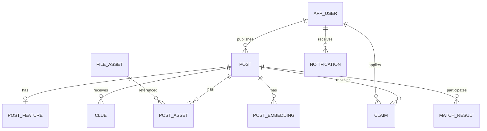

# 数据库设计

本文件用于分工建表和确认事务，不是已执行的 SQL。先看表关系，再查字段，最后检查约束。

数据库采用 MySQL、InnoDB 和 utf8mb4。精确版本与物理 DDL 在首个 Flyway 迁移中锁定。

## 1. 先理解数据之间的关系

图中 `post` 可表示寻物或招领，业务类型决定它能接收线索还是认领申请。匹配记录分别引用一条寻物和一条招领。

### 表归属速查

| 负责人 | 数据表 |
|---|---|
| A | 不直接维护数据库；通过 API 使用数据 |
| B | post、post_feature、post_asset、clue、clue_asset、claim、claim_asset、notification |
| C | ai_draft、post_embedding、match_result、ai_call_log、job |
| D | 用户、会话、字典、文件、举报、操作日志、幂等记录 |

## 2. 通用存储约定

| 项目 | 约定 |
|---|---|
| ID | 服务端 BIGINT，API 用十进制字符串 |
| 公共字段 | 所有表含 id、created_at、updated_at |
| 精确时间 | UTC 写入 DATETIME(3)，接口带时区 |
| 模糊时间 | 日期、时段和精度分开保存 |
| 枚举 | 可读字符串，应用层校验 |
| 迁移 | Flyway；已执行脚本不回改 |
| 未知值 | NULL 或空列表，不用“未知”占位参与评分 |

下文表格省略公共字段。字段长度属于初始建议，最终与业务限制一起校验。

B、C、D 各写自己的迁移和 Mapper；D 协调共享迁移编号。Mapper XML 分别放 `resources/mapper/business/`、`intelligence/`、`platform/`，不相互改表。

## 3. 用户、会话与字典（D）

### 3.1 app_user：平台用户

| 字段 | 类型或约束 | 含义 |
|---|---|---|
| `openid` | VARCHAR(128)，唯一，可空 | 微信标识；独立管理员可空 |
| `nickname` | VARCHAR(64) | 平台昵称 |
| `avatar_file_id` | BIGINT，可空 | 头像文件 |
| `role` | USER / ADMIN | 角色 |
| `status` | ACTIVE / RESTRICTED | 账号是否可用 |

### 3.2 admin_credential：管理员凭据

| 字段 | 类型或约束 | 含义 |
|---|---|---|
| `user_id` | 唯一 | 对应用户 |
| `username` | 唯一 | 管理端账号 |
| `password_hash` | 哈希值 | 不存明文密码 |

### 3.3 auth_session：平台登录会话

| 字段 | 类型或约束 | 含义 |
|---|---|---|
| `user_id` | BIGINT | 会话所属用户 |
| `token_hash` | 唯一 | 平台随机 token 的哈希 |
| `expires_at` | 时间点 | 到期时间 |
| `revoked_at` | 可空时间点 | 撤销时间 |

token 原值只在登录时返回，不写数据库或日志。限制账号时撤销会话。

### 3.4 category 与 campus_location：基础字典

| 表 | 字段 | 用途 |
|---|---|---|
| category | name、sort_order、enabled | 分类名称、排序、启用 |
| campus_location | name、area、enabled | 地点名称、区域、启用 |

已引用条目采用停用，不删除历史含义。地点不确定时，帖子 `location_id=NULL`。

## 4. 信息与正式特征（B）

### 4.1 post：寻物或招领信息

| 字段 | 类型或约束 | 含义 |
|---|---|---|
| `owner_id` | BIGINT | 发布者 |
| `type` | LOST / FOUND | 寻物或招领 |
| `title` | VARCHAR(100) | 标题，业务限制更严格 |
| `category_id` | BIGINT | 分类 |
| `location_id` | BIGINT，可空 | 校园地点 |
| `description` | TEXT | 公开描述 |
| `time_precision` | EXACT / PERIOD / DATE / UNKNOWN | 时间精度 |
| `event_at` | DATETIME(3)，可空 | 准确时间，UTC |
| `event_date` | DATE，可空 | 校园本地日期；EXACT 由服务端根据 event_at 派生 |
| `time_period` | 可空枚举 | MORNING、AFTERNOON、EVENING |
| `status` | OPEN / PROCESSING / RESOLVED / CLOSED | 业务状态 |
| `moderation_status` | VISIBLE / HIDDEN | 管理状态 |
| `content_version` | INT | 内容变更时递增 |
| `row_version` | INT | 内容、业务状态或管理状态变更时递增 |

**两个版本不要混用：**内容版本使旧 AI 结果失效；行版本防止编辑覆盖刚发生的认领状态。

建议索引：

- `(type, moderation_status, status, category_id, created_at)`
- `(owner_id, created_at)`
- `(location_id, event_date)`

初版关键词可用参数化 LIKE。是否增加全文索引按实际规模评估。

### 4.2 post_feature：用户确认的特征

| 字段 | 类型或约束 | 含义 |
|---|---|---|
| `post_id` | 唯一 | 一条信息一份特征 |
| `color` | VARCHAR(64)，可空 | 颜色 |
| `brand` | VARCHAR(128)，可空 | 品牌 |
| `appearance` | JSON 字符串列表 | 外观特征 |

这是正式数据，AI 草稿不能直接覆盖。

### 4.3 post_asset：信息图片关联

| 字段 | 类型或约束 | 含义 |
|---|---|---|
| `post_id` | BIGINT | 信息 |
| `file_id` | BIGINT | 已上传文件 |
| `sort_order` | 整数 | 展示顺序 |

唯一约束：`(post_id, file_id)`。与信息、正式特征同事务保存。

## 5. 文件与幂等（D）

### 5.1 file_asset：文件元数据

| 字段 | 类型或约束 | 含义 |
|---|---|---|
| `owner_id` | BIGINT | 上传者 |
| `storage_key` | 唯一 | 随机存储键，不是用户输入路径 |
| `purpose` | POST_IMAGE / CLUE_IMAGE / CLAIM_PROOF / AVATAR | 用途 |
| `mime_type` | 字符串 | 实际文件类型 |
| `byte_size` | 整数 | 大小 |
| `checksum` | 摘要 | 内容校验 |
| `lifecycle_state` | TEMP / ATTACHED / DELETED | 生命周期 |
| `uploaded_at` | 时间点 | 上传时间 |

访问权限由关联业务推导，不接受前端 `public=true`。证明不保存永久公开链接；私密读取使用短期许可。

### 5.2 idempotency_record：重复请求去重

| 字段 | 类型或约束 | 含义 |
|---|---|---|
| `user_id` | BIGINT | 发起用户 |
| `operation` | 字符串 | 操作类型 |
| `client_request_id` | 字符串 | 本次操作标识 |
| `request_hash` | 摘要 | 检查相同键是否对应相同内容 |
| `resource_id` | 可空 ID | 已有业务资源 |
| `response_snapshot` | JSON | 可复用的安全响应 |
| `expires_at` | 时间点 | 去重保留期限 |

唯一约束：`(user_id, operation, client_request_id)`。

相同键、相同内容返回已有结果；相同键、不同内容返回冲突。记录与业务写入同事务提交。保留期限配置化，过期后不保证去重。

request_hash 覆盖 HTTP 方法、规范化资源路径和正文，不能只哈希正文。并发重试先锁定幂等记录，再取当前已提交结果；失败事务不留下永久“处理中”记录。

## 6. AI 与匹配（C）

### 6.1 ai_draft：提取建议

| 字段 | 类型或约束 | 含义 |
|---|---|---|
| `owner_id` | BIGINT | 任务本人 |
| `job_id` | 唯一 | 提取任务 |
| `input_hash` | 摘要 | 识别输入版本 |
| `suggested_features` | JSON | 尚未确认的建议 |
| `model_id` | 字符串 | 模型配置标识 |
| `prompt_version` | 字符串 | 提示词版本 |
| `expires_at` | 时间点 | 保留期限 |

### 6.2 post_embedding：文本向量

| 字段 | 类型或约束 | 含义 |
|---|---|---|
| `post_id` | BIGINT | 信息 |
| `content_version` | INT | 内容版本 |
| `model_id` | 字符串 | 模型与配置标识 |
| `dimension` | INT | 向量维度 |
| `normalizer_version` | 字符串 | 标准文本生成规则版本 |
| `text_hash` | 摘要 | 标准文本摘要 |
| `vector_data` | MEDIUMBLOB | 固定格式的向量数据 |

唯一约束：`(post_id, content_version, model_id, normalizer_version)`。比较前检查模型、维度与文本规范化版本，不依赖 MySQL 原生向量类型。

### 6.3 match_result：双向匹配关系

| 字段 | 类型或约束 | 含义 |
|---|---|---|
| `lost_post_id / found_post_id` | 两个 BIGINT | 寻物与招领 |
| `lost_version / found_version` | 两个 INT | 双方内容版本 |
| `rule_score` | 数值 | 规则分 |
| `semantic_score` | 可空数值 | 语义相似度 |
| `ranking_score` | 数值 | 内部排序分 |
| `evidence` | JSON | 实际匹配依据 |
| `mode` | RULE_BASED / HYBRID | 推荐方式 |
| `algorithm_version` | 字符串 | 评分算法版本 |
| `calculated_at` | 时间点 | 计算时间 |

唯一约束：`(lost_post_id, found_post_id)`。为两端分别建立查询排序索引。

读取时联查双方版本、业务状态和可见性；不能只依赖后台清理。算法切换时按策略失效或重建。

### 6.4 ai_call_log：调用摘要

| 字段 | 记录内容 |
|---|---|
| job_id | 所属任务 |
| provider、model_id | 服务与模型 |
| duration_ms、status、error_code | 时延与结果 |
| input_units、output_units | 可获得的用量，允许空 |

默认不记录原图、完整提示词、证明和联系方式。

## 7. job：持久化任务（C）

| 字段 | 类型或约束 | 含义 |
|---|---|---|
| `type` | EXTRACT_FEATURES / REFRESH_MATCHES | 任务类型 |
| `owner_id` | BIGINT | 所属用户 |
| `target_id / target_version` | 可空 ID / 内容版本 | 匹配任务必须指定目标 |
| `target_row_version` | 可空 INT | 捕获可匹配状态版本，恢复后可刷新 |
| `algorithm_version` | 可空字符串 | 规则、模型和规范化配置版本 |
| `run_seq` | INT | 同一任务重排时递增，识别新一次执行 |
| `dedupe_key` | 唯一 | 避免重复入队 |
| `payload` | JSON | 必要输入引用 |
| `state` | 任务枚举 | 排队、执行、完成、失败或过时 |
| `attempts / next_run_at` | 次数 / 时间点 | 重试控制 |
| `locked_by / lease_until` | 租约标识 / 时间点 | 领取与恢复 |
| `result / error_code` | 可空结果 / 错误码 | 执行结果 |

索引：`(state,next_run_at)`、`(state,lease_until)`、`(owner_id,created_at)`。

领取、续租和完成都检查 locked_by 随机租约标识、run_seq、lease_until。过期执行者不能提交。

匹配去重键包含 postId、rowVersion、algorithmVersion。同键正在执行则复用；终态在冷却期后可显式重排并递增 run_seq。失败任务也可重排，不能被唯一键永久锁死。

模型调用在事务外执行。用户提取请求可限额拒绝，但业务发布入队不因模型额度、模型失败或执行线程繁忙而拒绝；优先合并同目标排队任务。

## 8. 线索、认领与通知（B）

### 8.1 clue 与 clue_asset：私密线索

| 表 | 主要字段 |
|---|---|
| clue | lost_post_id、author_id、content、sighting_at、location_id |
| clue_asset | clue_id、file_id，联合唯一 |

目击时间、地点可空。发布者与提交者按权限读取，默认不公开。

### 8.2 claim：认领申请

| 字段 | 类型或约束 | 含义 |
|---|---|---|
| `found_post_id` | BIGINT | 被认领的招领 |
| `applicant_id` | BIGINT | 申请人 |
| `related_lost_post_id` | 可空 BIGINT | 申请人自己的寻物 |
| `found_content_version` | INT | 提交申请时的招领内容版本 |
| `related_lost_content_version` | 可空 INT | 提交时关联寻物的内容版本 |
| `proof_text` | TEXT | 私密核验说明 |
| `applicant_contact` | JSON | 申请人交接方式 |
| `finder_contact` | 可空 JSON | 拾取者接受时提供 |
| `status` | 申请枚举 | 详见需求状态表 |
| `cancelled_by_id / cancel_reason` | 可空用户 ID / 文本 | 谁取消及原因 |
| `end_reason` | 可空原因 | 结束原因 |
| `accepted_at / completed_at` | 可空时间点 | 接受与归还时间 |

索引：`(found_post_id,status)`、`(applicant_id,created_at)`、`(related_lost_post_id,status)`。

不要使用 `UNIQUE(found_post_id,status)`：它会错误地限制多份待处理申请。所有申请创建、接受、取消、归还、关闭和下架操作按统一锁顺序执行，详见 [对接约定](12-integration-contracts.md)。

接受时同时锁 FOUND 与关联 LOST，使用当前读检查两端没有其他 ACCEPTED，防止同一寻物在不同招领里同时被接受。

接受时也比较申请保存的两端内容版本。编辑过的旧申请返回 CLAIM_CONTENT_CHANGED；查询返回 stale=true 与合法动作，申请人撤销后重新申请。

claim_asset 保存 `claim_id、file_id`，联合唯一。第一版证明仅相关双方读取；管理端默认只能读处理摘要，不提供原始证明接口。

### 8.3 notification：站内消息

| 字段 | 类型或约束 | 含义 |
|---|---|---|
| `recipient_id` | BIGINT | 收件人 |
| `type / business_id` | 类型 / ID | 业务引用 |
| `dedupe_key` | 唯一 | 避免同一事件重复通知 |
| `safe_payload` | JSON | 安全摘要，不含证明和联系方式 |
| `read_at` | 可空时间点 | 已读状态 |

索引：`(recipient_id,read_at,created_at)`。联系方式仅在接受后的相关申请详情展示，不进入通知。

## 9. 举报与操作日志（D）

| 表 | 主要字段 |
|---|---|
| report | reporter_id、post_id、reason_code、description、status |
| report 的处理字段 | handler_id、resolution、handled_at |
| admin_operation_log | admin_id、action、target_type、target_id、reason、request_id |

不记录明文密码、token 或证明正文。

## 10. 哪些修改必须一起成功

| 操作 | 同一事务内必须完成 |
|---|---|
| 发布或编辑 | 信息、特征、附件、版本、匹配任务、幂等结果 |
| 申请 | 父状态检查、活动申请检查、申请、附件、通知、幂等结果 |
| 接受 | 父信息加锁、申请 ACCEPTED、信息 PROCESSING、交接字段、通知 |
| 取消已接受 | 申请 CANCELLED、信息 OPEN、通知、重新匹配任务 |
| 归还 | 信息 RESOLVED、申请 COMPLETED、其他申请 ENDED、合法关联寻物结束、通知 |
| 关闭或解决 | 合法状态、关联流程、信息状态、通知 |
| 下架或恢复 | 管理状态、关联申请结束/释放交接、受影响信息版本、通知、日志、重新匹配任务 |

多条信息加锁时按 ID 升序，先锁信息再锁申请，不允许先锁单条 FOUND 后再补锁更小 ID 的 LOST。关联集合变化时回滚并重试，不边持锁边扩充更早层级的锁。

事务内校验使用当前锁定读，不使用此前普通查询的快照作为最终状态。可重试死锁采用有限重试。

外部 AI 和微信推送不参加数据库事务。

## 11. 数据准备

虚构样例放 [tests/fixtures](../tests/fixtures/)，AI 标注合同见 [评测说明](../tests/ai-evaluation/README.md)。

课程资料留在项目外的 CourseDocument，不自动上传模型。校园地点应由团队核实后录入。

下一步：[接口说明](04-api-contracts.md) · [测试与验收](07-testing.md)
