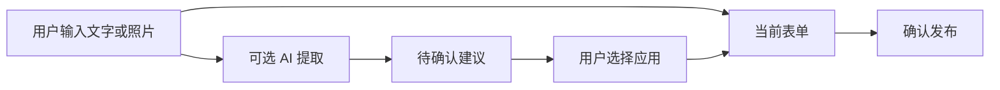

# 小程序设计

本文件用于页面和组件开发。页面调用什么接口见 [接口说明](04-api-contracts.md)，业务状态以 [需求规格](01-requirements.md) 为准。

**负责人 A：整个小程序的页面、组件、工具和接口调用均由 A 主维护。** B/C/D 提供后端合同和联调支持，不再拆写学生端组件。

技术采用原生 TypeScript、WXML、WXSS。当前是目录骨架，尚需初始化 app.json、app.ts 和开发者工具配置。

## 1. 页面怎样组织

### 主包：四个底部入口

| 页面 | 功能 | 负责人 |
|---|---|---|
| home | 列表、搜索、筛选 | A |
| publish | 发布、上传、AI 建议 | A |
| messages | 通知、未读状态 | A |
| me | 个人资料、业务入口 | A |

### 普通分包：业务详情

| 分包 | 页面 | 负责人 |
|---|---|---|
| post | detail、edit、mine | A |
| matching | results | A |
| recovery | clue-create、clues | A |
| recovery | apply、list、detail | A |
| account | profile、report | A |

页面文件成组创建：index.ts、index.wxml、index.wxss、index.json。

公共组件放主包 components，普通分包复用它们，不互相引用另一分包的实现。

## 2. 页面、服务和工具各做什么

| 部分 | 职责 | 例子 |
|---|---|---|
| 页面 | 操作、展示、错误提示 | 发布按钮、失败重试 |
| 组件 | 可复用交互 | 图片上传器、AI 建议面板 |
| services | 业务请求与类型 | createPost、getMatches |
| utils | 网络、身份、轮询 | request、auth、job-poller |

services 不直接弹提示，工具不依赖页面实例。是否能编辑、申请等，以后端返回和再次鉴权为准。

### services 按 API 来源分组

- `services/business/`：调用 B 的信息、认领和通知。
- `services/intelligence/`：调用 C 的 AI 与匹配。
- `services/platform/`：调用 D 的登录、文件和字典。

三个目录的客户端代码都由 A 维护，不代表后端负责人直接修改小程序。

## 3. 发布页的数据流

### 手动填写和 AI 建议分开存



AI 组件输入：

| 属性 | 用途 |
|---|---|
| text | 当前描述 |
| fileIds | 已上传图片 |
| inputRevision | 本地输入版本 |

组件发出 applySuggestion、discardSuggestion 事件，由页面决定修改哪些字段。

用户修改输入后，旧建议标记过时，不能自动覆盖新内容。更新页面时只 setData 必要字段，不反复复制大图和整个长列表。

### 未登录时

可以浏览公开信息。点击发布、认领等操作时再登录，并保留表单草稿；不用每次启动都强迫填写个人资料。

## 4. 图片上传器

### 组件输入和事件

| 类型 | 名称 | 含义 |
|---|---|---|
| 属性 | purpose | 上传用途 |
| 属性 | maxCount | 图片数量限制 |
| 属性 | existingFiles | 已有附件 |
| 事件 | change | 成功的 fileId 列表 |
| 事件 | busyChange | 是否正在上传 |
| 事件 | error | 单图失败信息 |

### 每张图片的状态

```text
LOCAL → UPLOADING → UPLOADED
               ↘ FAILED → 可重试
```

- 删除上传中的图片时，取消或忽略其旧回调。
- 单图失败可以重试，不能悄悄丢弃附件后发布。
- 本地临时路径用于预览，上传成功后用 fileId 提交。
- 私密远程图先请求短期许可，过期后重新申请。
- 页面状态不保存大段 base64，不把平台 token 拼到图片 URL。

## 5. 公共工具

| 工具 | 要处理的内容 |
|---|---|
| request | API 地址、token、HTTP 与业务错误、requestId |
| upload | wx.uploadFile、name=file、字符串 data 解析 |
| auth | wx.login、新 code、平台 token、并发登录合并 |
| job-poller | 区分提取与匹配查询路径，按任务查询、退避、停止与恢复 |

同一次提交重试保持 clientRequestId；用户改变内容发起新业务时重新生成。创建申请和接受、取消、完成等动作同样带幂等标识。

上传及 POST 的网络失败不能自动视为服务端未执行。先用已有任务号或幂等键恢复，再由用户明确发起新操作。

登录失败、账号受限、网络失败分别提示。任务失败后不通过循环创建新任务实现“重试”。

## 6. 页面生命周期

| 时机 | 处理 |
|---|---|
| onLoad | 解析路由和对象 ID |
| onShow | 获取最新状态，恢复已有任务查询 |
| onHide | 停止轮询，保存必要草稿 |
| onUnload | 释放监听，防止旧回调更新页面 |

初始轮询可采用 2 秒，再退避到 5 秒，并设置总等待上限。离开页面不影响服务器任务执行。

本地缓存只改善体验，不能代替后端真相。返回详情时刷新 allowedActions；退出或切换账号时清除私密草稿、临时图地址和任务引用。

未上传的本地图片可能失效，再进入时允许用户重选。

## 7. 每类页面要覆盖的状态

| 页面 | 必须显示的状态 |
|---|---|
| 列表 | 加载、空、失败重试、已到底 |
| 详情 | 正常、关闭、解决、下架、对象不存在 |
| 发布 | 未登录、字段错误、上传失败、提交中 |
| AI 面板 | 排队、执行、失败、旧建议、用户舍弃 |
| 认领 | 已被处理、他人已接受、状态冲突、证明许可失效 |

消息先在进入页面或回前台时刷新，不建立实时长连接。校园地点使用字典，不要求 GPS。

## 8. 真机验收

- 实际 AppID 与开发协作权限。
- 正确的 API 环境、HTTPS 和服务器域名。
- 登录、失效后重新登录。
- 上传、公开图与私密图。
- 前后台切换、轮询恢复、草稿保留。

开发者工具通过不能替代真机验证。官方参考见 [总体架构](../ARCHITECTURE.md)。

下一步：[AI 设计](06-ai-and-matching.md) · [测试验收](07-testing.md)
