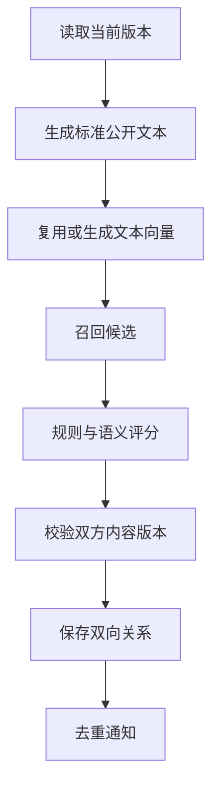

# AI 与匹配设计

本文件解释两项 AI 能力、推荐算法和任务恢复。先看用户流程，再看后台实现。

**负责人 C：完整维护 ai、matching 和 job。** A 负责界面，B 负责正式信息与通知，D 负责平台权限、文件和运行配置。

**第一版路线：图片转特征，用户确认后，与文字一起参与匹配。**

## 1. 两项能力

| 能力 | 输入 | 输出 | 用户动作 |
|---|---|---|---|
| 智能草稿 | 文字、照片或两者 | 待确认的类别、颜色、外观等 | 确认或修改 |
| 语义推荐 | 正式公开特征与描述 | 候选排序与理由 | 查看、联系、核验 |

没有照片也可匹配。AI 不自动认领、不改正式信息，不读取私密证明进行公共推荐。

### 外部能力接口

| 接口 | 用途 |
|---|---|
| FeatureExtractionGateway | 图文提取，返回 DraftFeatures |
| TextEmbeddingGateway | 文本向量，返回模型、维度和数字向量 |
| MatchingPolicy | 结合规则与可比较向量进行排序 |

服务商响应在适配层转换和校验。API key、地址和模型配置留在后端。

模型服务尚未锁定，先从实际部署网络验证中文、图片、格式、时延、维度、配额和费用。mock 仅供联调。

## 2. 智能草稿如何生成

```text
校验用户与附件
    → 创建提取任务
    → 调用图文服务
    → 校验输出
    → 保存草稿
    → 用户应用到表单
```

### 需要校验什么

| 项目 | 规则 |
|---|---|
| 输入 | 文字和图片至少一种 |
| 图片 | 本人上传，正确用途，输入尺寸受控 |
| 类别和地点 | 必须能对应字典，不能确认则未知 |
| 时间 | 保留精度，相对时间结合参考时区 |
| 品牌和外观 | 看不清不猜测 |
| 输出 | 类型、长度、列表和字段组合均校验 |

用户描述和图片文字是待处理数据，不是执行指令。模型不持有数据库写入或认领审批工具。

草稿结构错误时有限修复或重试；仍失败就明确返回失败，不能保存虚构内容。

## 3. 一次匹配如何完成

B 的发布用例通过 C 的 JobService，在同一事务保存信息与 REFRESH_MATCHES 任务。两个区域共享同一数据源与事务管理器；JobService 入队不能另开独立提交事务。

C 通过 B 的只读 PostQueryService 获取候选，通过 NotificationService 创建站内消息，不直接改业务表。



标准文本使用类别、颜色、品牌、确认外观和公开描述。未知字段省略，未确认的 AI 草稿不直接加入。

openid、交接账号、proofText 和证明图片不发送给公共匹配模型。

## 4. 怎样找候选、怎样排序

### 4.1 必须满足的条件

- 相反类型：LOST 对 FOUND。
- 单校园部署、不同发布者。第一版无多校园租户逻辑；未来增加校园后需补全 campusId 隔离。
- 状态 OPEN、管理状态 VISIBLE。

### 4.2 可以逐步放宽的条件

类别、日期范围、地点、颜色、品牌和关键词用于缩小范围。候选不足时逐步扩大，不能因为地点不完全相同就排除可能相关物品。

候选上限初设为可配置的 200 条。必须检查截断是否漏掉正确结果，而非只测计算速度。

### 4.3 评分原则

| 情况 | 处理 |
|---|---|
| 明确一致 | 增加相应规则证据 |
| 未填写 | 视为未知，不当冲突 |
| 明确冲突 | 根据可信度降低优先级 |
| 可比较字段很少 | 降低证据完整程度，避免虚高 |
| 描述含义接近 | 加入语义相似度 |
| 无合理候选 | 返回空列表 |

时间要结合精度理解：拾取发生在丢失之后很正常；明确早于丢失才可能冲突。

先建立规则版，再加入向量语义。权重用独立调参样本调整，不预先宣称某个比例最优。

### 4.4 推荐理由

理由从实际证据生成：

- 颜色确实一致，才显示“颜色一致”。
- 仅语义相近，显示“描述语义相近”。
- 不调用模型随意编写没有数据支持的理由。
- 不把排序分展示为“这是你的物品”的概率。

## 5. 向量、双向关系与版本

### 向量怎样保存

每个信息内容版本、模型配置最多一个有效向量，存在数据库中，由 Java 在候选集内计算相似度。

比较前检查模型、维度与文本规范化版本；normalizerVersion 持久化保存并参与复用键。切换模型后重新构建，过渡期使用规则结果。

第一版不要求向量数据库。

### 匹配为什么需要两个版本

一条关系同时引用寻物和招领。任意一边编辑，旧比较都可能失效。

因此写入和读取时都检查双方内容版本，并即时检查状态与可见性。匹配任务额外记录 source rowVersion、algorithmVersion；恢复状态可触发新任务。

提交结果前，在一个短事务中按 ID 升序锁定双方信息，再锁任务行，检查版本和租约后写入，防止“校验后到写入前”被并发编辑。相同版本、相同算法已存在 HYBRID 时，迟到的 RULE_BASED 结果不能覆盖它。已下架或已解决的信息不等待清理任务才退出结果。

关系可从双方查询。只有达到阈值的新关系才发消息，不能每次轮询都提醒。

## 6. 后台任务怎样可靠执行

C 在 `modules/intelligence/job/` 维护通用执行框架，并自行实现两类处理器：

| 类型 | 作用 |
|---|---|
| EXTRACT_FEATURES | 提取发布草稿 |
| REFRESH_MATCHES | 准备向量、评分、刷新关系 |

### 执行步骤

1. 到期任务被调度器扫描。
2. 短事务领取任务并获得租约。
3. 有界线程池调用模型，期间不持数据库行锁。
4. 短事务校验租约、内容版本，保存结果。
5. 临时故障退避重试，最终失败保留安全错误码。
6. 租约过期后可恢复，旧执行者不能提交结果。

初始并发 2 个模型线程、最多尝试 3 次，均按真实耗时调整。一次任务只生成或复用源信息向量，批量读取候选已有向量，不为 200 个候选逐个发模型请求。缺向量的候选先按规则评分，待其自身任务完成后更新双向关系。参数或权限错误不盲目重试。

### 任务状态

| 状态 | 含义 |
|---|---|
| QUEUED | 排队或等待重试 |
| RUNNING | 执行中 |
| SUCCEEDED | 完成 |
| FAILED | 最终失败 |
| SUPERSEDED | 内容已变，结果作废 |

任务允许至少一次执行，依靠幂等保存与唯一键避免重复副作用，不承诺服务商绝不重复计费。

只使用 @Async 或内存事件无法提供重启恢复，任务必须先落库。

## 7. 失败时怎样退回基础能力

| 故障 | 用户看到什么 | 后端怎样处理 |
|---|---|---|
| 图片识别失败 | 可手动填，保留图片 | 任务失败，可显式重试 |
| 草稿结构无效 | 不应用错误建议 | 有限修复后失败 |
| 向量服务故障或超额 | 规则推荐仍可用 | 标记语义不可用 |
| 后端重启 | 回来后查已有任务 | 恢复过期租约 |
| 用户修改内容 | 新规则结果或等待语义 | 旧任务作废 |

mode 表示 RULE_BASED 或 HYBRID；每个结果项也带 mode。至少一个返回项用到语义时总 mode=HYBRID；向量覆盖不足时 semanticStatus=PARTIAL。

refreshState 表示执行状态。一次规则结果完成，不等于语义模型成功。

## 8. 成本与效果怎样验证

### 成本控制

- 用户级提取和刷新限流。
- 提取请求队列上限、全局模型日额度。
- 发布用的刷新任务落库不因模型额度或执行线程繁忙而失败；合并排队任务，模型不可用时规则执行。
- 手动重排受冷却期约束；去重键包含 rowVersion、algorithmVersion，终态重排增加 run_seq。
- 按内容摘要和模型版本复用有效结果。
- 不通过跨用户缓存泄漏私密图片。
- 日志只记必要用量和时延，不默认记录原图和完整描述。

### 评测场景

| 场景 | 要检查的问题 |
|---|---|
| 不同说法、同一物品 | 语义是否帮助召回 |
| 同款不同物、同色不同类 | 是否过度推荐 |
| 无图片、缺字段 | 是否仍可用 |
| 地点不同、时间不确定 | 召回是否过严 |
| 明确时间冲突 | 是否合理降权 |
| 没有正确候选 | 是否能不给推荐 |

规则版与混合版用相同样本和候选对比。检查 Recall@5、无正例误推荐率、时延和费用；调参集与验收集分开。

样本格式见 [AI 评测资料](../tests/ai-evaluation/README.md)，用例见 [测试验收](07-testing.md)。
