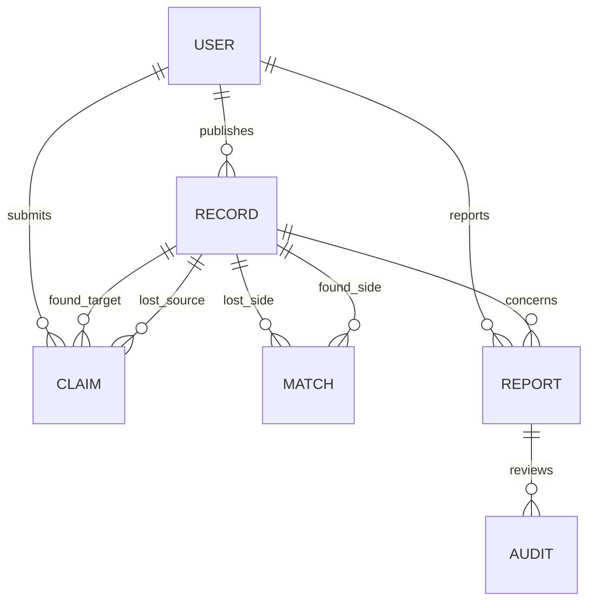
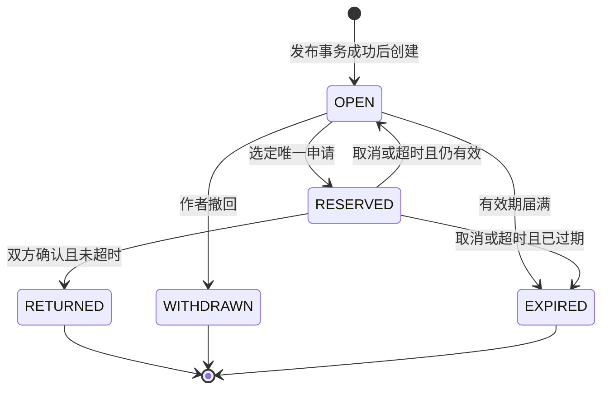

# 校园失物招领与线索匹配平台需求分析文档

作者：xx  
原编写日期：2026年10月10日  
本次修订日期：2026年10月14日  
版本：V1.2  
文档性质：单校试点需求基线，供设计、开发和验收使用

### 0.1 需求—来源—优先级—验收总览

本表是第7/8节权威条目的索引，子项在末尾单列；20项F与10项N仍按父项计数。脚本核对索引与原行一致，不将索引行当成新需求。

|需求索引|优先级|来源/关联|验收|正文定位|
|---|---|---|---|---|
|F-01｜身份与权限|高|S1、S2、A2、G2|T-01|第7节|
|F-02｜寻物发布|高|S3、SC1、SC5、G1|T-02|第7节|
|F-03｜招领发布|高|S8、SC2、G2|T-03|第7节|
|F-04｜条件检索|高|S3、SC5、G1|T-04|第7节|
|F-05｜自动匹配|高|S8、S12、A4、SC1|T-05, T-17|第7节|
|F-06｜候选解释|高|S2、S8、G2|T-06|第7节|
|F-07｜认领申请|高|S8、SC2、B-02|T-07, T-18|第7节|
|F-08｜核验与选定|高|S8、SC3、B-03|T-08|第7节|
|F-09｜私密交接|高|S8、SC3、B-04|T-09|第7节|
|F-10｜双方确认|高|S8、SC3、G2|T-10|第7节|
|F-11｜到期处理|高|S2、A3、G3|T-11|第7节|
|F-12｜举报与隐藏|高|S2、S8、UC-04|T-12|第7节|
|F-13｜冻结与申诉|高|S8、S13、G2、B-08、A2|T-13, T-13a, T-13c|第7节|
|F-14｜我的记录与维护|高|S3、SC1、G3|T-14|第7节|
|F-15｜管理审计|高|S4、G3、B-10|T-15|第7节|
|F-16｜清理与注销|高|S2、A3、B-10|T-16, TN-07|第7节|
|F-17｜站内通知|高|S8、SC1—SC4、G3|T-17|第7节|
|F-18｜重试与限流|高|S2、SC6、B-02|T-18|第7节|
|F-19｜收藏线索|中|S3、S13、G1|T-19, T-19a, T-19c|第7节|
|F-20｜聚合统计|低|S4、xx范围分析、G3|T-20|第7节|
|N-01｜性能容量|高|S2、A1|TN-01|第8节|
|N-02｜可用与恢复|高|S2、SC6|TN-02|第8节|
|N-03｜安全隐私|高|S2、S8、SC2|TN-03|第8节|
|N-04｜易用性|高|S2、S3、SC1|TN-04|第8节|
|N-05｜基础无障碍|中|S2、xx界面分析|TN-05|第8节|
|N-06｜一致性|高|S2、SC6、B-03|TN-06|第8节|
|N-07｜保留与备份|高|A3、S2|TN-07|第8节|
|N-08｜兼容性|中|S2、xx环境约束|TN-08|第8节|
|N-09｜任务时效与诊断|a/b高；c中|S2、S13、G3|TN-09, TN-09a, TN-09c|第8节|
|N-10｜规则可维护|低|S4、A4|TN-10|第8节|
|F-13a/F-13b/F-13c|高|S8/S9/S13、A2/A3、B-08|T-13a/T-13b/T-13c|7.1、3.3|
|F-19a/F-19b/F-19c|中|S2/S3/S13、B-10|T-19a/T-19b/T-19c|7.1|
|N-09a/N-09b/N-09c|高/高/中|S2/S9/S13|TN-09a/TN-09b/TN-09c|8.1|

## 1 背景与问题陈述

本项目要解决的核心问题是：失主如何在校园内发现可能属于自己的物品，并在保护隐私的前提下完成可信的交接。平台将寻物信息与招领信息结构化管理，通过可解释的规则给出候选线索，再由双方核验和确认交接。系统不会凭借相似度判定物品所有权。

当前的业务问题假设是：群聊消息和公告中的失物信息容易被覆盖，时间、地点、类别的表达不一致，用户难以判断某条信息是否仍然有效；直接展示联系方式和证件照片可能增加骚扰及冒领风险。这些是本项目用于场景分析的假设，尚无真实访谈或校园统计数据支持。本文不将其写成已经调查证实的事实。

### 1.1 NABCD分析

|维度|分析与业务含义|
|---|---|
|Need|降低寻找有效招领线索及核验物主的操作成本，避免只做信息发布墙而没有交接闭环。|
|Approach|采用校内身份、结构化发布、规则匹配、私密认领证据、双方确认和管理员复核。|
|Benefit|预期减少重复搜索和无效联系；发布、匹配、认领都能追踪状态。实际改善幅度需试点比较，本文不承诺找回率。|
|Competitors|群聊、公告栏、人工失物登记作为替代流程类型进行比较，不声称调查过特定学校或商业产品。群聊操作熟悉但结构化检索及状态维护能力有限；人工登记可核验实物，但线上查询取决于值班人员。|
|Delivery|拟经学校许可，在一个校区试点；通过校园入口链接和线下登记点二维码推广，不自动导入群聊或既有登记数据。|

### 1.2 目标及衡量方式

|业务目标|关联用户结果|衡量方法|
|---|---|---|
|G1 可找到有效信息|学生能发布并定位候选物品|按UC-01、UC-02和N-04的任务完成率验收。|
|G2 降低误领风险|核验不泄露给其他申请人，交接有记录|按UC-03及T-07至T-10验收；不将“零冒领”作为无法保证的承诺。|
|G3 管理有效性和异常|记录可撤回、过期、举报、追踪|按UC-04及T-11至T-15验收。|

## 2 依据、获取方法与假设

### 2.1 来源登记

来源编号在功能、非功能需求和验收项中复用；课程资料支持分析方法，不作为校园业务事实的证据。页码为PDF文件页码。

|编号|来源|支持内容|
|---|---|---|
|S1|task/task.md，任务与约束、提交清单|自定义选题许可；背景、用户场景、功能、非功能、优先级、验收、边界及协作核实要求。|
|S2|task/gradingCriteria.md，六项评分标准|合理可行、异常处理、输入输出、可验证、优先级、一致性、追溯及核实。|
|S3|CourseDocument/Ch3-如何获取用户的真实需求.pdf，第39—41、48—55、75页|虚拟画像、场景模拟、功能与状态建模、MVP分析。|
|S4|同上，第78—83、87—91页|质量评审、明确验收标准、唯一标识、追踪矩阵、变更影响分析。|
|S5|CourseDocument/Ch2-过去我们是如何开发软件的.pdf，第19—21页|需求获取、分析、确认、管理；区分需求与设计。|
|S6|CourseDocument/Ch1-什么是软件工程.pdf，第56—57页|Given／When／Then形式的可观察验收标准。|
|S7|CourseDocument/软件工程实践课程教案.docx，附录中的“NABCD模型介绍”和周报系统需求示例|问题价值分析、用户故事及条件化验收表述。|
|S8|xx与agent第1轮，见02_协作记录.md|候选涉众、风险及业务规则；经xx选择后形成需求。|
|S9|xx与agent第2轮及第3轮，见02_协作记录.md|交叉评审与修订；不替代真实涉众确认。|
|S10|xx核实，见03_核实说明.md及evidence目录|规则演算、场景推演、结构追溯检查。|
|S11|芜湖学院后勤与保卫管理处，2024-05-09《失物招领管理办法（试行）》；URL与访问日期见evidence/外部参照依据.md|按日期整理、阶段性认领及有限周期管理的参照；不作为本校数字期限依据。|
|S12|武汉大学图书馆公开失物招领页面；URL与访问日期见evidence/外部参照依据.md|日期、地点、暂存地和状态等结构化字段的参照；不证明匹配命中率。|
|S13|作者2026-10-14提供的第2次提交98分评价及本轮修订指令；02第7节CR-16—CR-20|DRAFT统一、治理时限、子条目、可操作取样及测量口径的改进依据；不作为真实业务确认。|

S3—S7的逐页摘录、精确定位和解释见evidence/课程依据摘录.md；原文件SHA256及大小见evidence/来源文件指纹.json。F-02的S3精确定位为Ch3第40页情景模拟、第48页场景分析；发布表单具体字段由SC1/SC5推导，并非课程指定的校园政策。

### 2.2 获取过程及待确认事项

xx采用文档研究、虚拟角色场景推演、agent候选建议、反例评审和规则演算完成需求分析。未开展真实访谈、问卷、学校接口接入或软件压测。后续访谈计划：邀请失主、拾得者、线下保管人员各2人，以及管理员1人；使用匿名记录，不采集真实证件号码。重点询问最近一次找物过程、时间是否准确、可接受的证据与交接方式、管理员工作量。该计划尚未执行。作者在本轮明确回复“尚无真实记录，保持待确认”；访谈与个人批注表见05_作者复核与真实核实记录模板.md，空模板不计入已完成核实。

|假设|暂定内容及理由|待确认方式与不成立时的影响|
|---|---|---|
|A1|试点单校单校区，约5000个账户；活跃公开记录上限10000条、历史记录50000条。用于约束课堂项目规模。|学校提供匿名规模估计；超出则重估N-01及匹配批次，不直接承诺全校规模。|
|A2|学校能授权身份接入和至少1名管理员；课堂演示采用预置测试账户。|向学校确认身份协议及管理职责；不能确认则仅做封闭演示，不能宣称公开运营。|
|A3|公开有效期30天、选定交接保留48小时、终止内容/消息保留90天、案件和审计保留180天、备份轮替30天；详见生命周期表。用于避免无限滞留。|S11支持阶段性整理方向；各数字的推导与确认门槛见2.3。由试点管理方确认；不作为学校既定制度、法律期限或实物处置规则。|
|A4|类别、颜色、地点和事件时间足以形成基础候选排序。|S12支持结构字段方向，不支持权重或80%数字。100组有配对样本Top10命中率≥80%为待测验收预算；按6.5执行独立留出评估、降级、兜底与恢复判定。|
|A5|用户可在安全公共地点自行交接，管理员只处理争议和违规内容。|核实线下管理要求；若学校要求集中保管，应修改UC-03、角色权限和状态机。|

### 2.3 数字政策的初步依据与确认门槛

|政策|参照与项目推导（均待学校确认）|确认与变更条件|
|---|---|---|
|30天公开有效期|S11有按日期整理、阶段性集中认领和一个月公示的做法；仅借鉴月度复核节奏。在线线索30天后停止公开，减少陈旧信息，不意味着实体无人所有或可以处置。|试点负责人书面确认；至少访谈7名涉众，若至少2人报告常见找物周期超过30天，提交CR评估延长。|
|48小时选定保留|没有外部数字佐证；项目选择两个完整日夜作为校园双方约见的预算，避免长期占用。|至少5组匿名交接试用；若至少2组因上课/值班无法48小时交接，调整B-04并回归T-09/T-11。|
|90天终止正文/通知|没有外部数字佐证；以约三个月供短期纠错与复盘，和隐私清理成本权衡，不能由S11实物公示期推出。|负责人确认是否需要该复盘窗口；无复盘用途则缩短，不因案件开放自动延长证据。|
|180天案件/审计|没有外部数字佐证；以约一学期供争议复核和课堂试点追踪，属于管理预算。|负责人确认复核职责、最小字段与时限；不能确认则仅封闭演示。|
|30天备份、31天删除清单|没有外部数字佐证；30份日备份预算，清单多留1天覆盖最后一份旧备份轮替。|TN-07恢复演练核对轮替边界；若备份周期调整，清单至少覆盖全部可能含已删数据的备份。|

80%表示100个有真实标注配对的查询至少80个在前10项找到目标，允许至多20个漏判，属于业务容忍预算；尚无用户问卷或同类平台效果数据证明用户接受此预算。外部参照只使方向有初步佐证，不能将数字写为已证实事实。学校政策确认、真实样本和用户试用仍未完成。

## 3 用户、界面与权限

失主和拾得者是同一个校内用户在不同业务中的角色，一个人可以同时承担两种角色；管理员权限另行授予。

|角色|主要任务与界面|权限边界|
|---|---|---|
|未登录访问者|登录说明、使用帮助|不能浏览物品记录、图片或认领资料。|
|校内用户，失主|手机端寻物表单、筛选列表、候选解释、我的申请|可编辑自己的寻物记录；可针对有效招领记录申请认领。|
|校内用户，拾得者|招领表单、私密核验面板、交接确认|可管理自己的招领记录，查看该记录的认领证据；不能查看其他招领记录的私密证据。|
|管理员|桌面端举报队列、复核详情、操作理由、审计查询|可隐藏违规记录、冻结争议、查看被分配案件的证据；不能无理由浏览所有私密证据或替用户提交证据。|
|学校身份系统|提供校内身份结果|属于外部依赖，不负责物品归属或交接。|

普通浏览中，校内用户仅看到匿名昵称及公开字段；私密读取例外见第3.1节。联系方式不属于公开字段。管理员的敏感访问记录主体、案件、时间和理由；管理员涉及本人记录时不得处理，由另一管理员接手。试点仅有一名管理员且其为当事人时，按3.3进入有期限的回避等待；冻结不停止记录或交接时钟，不能无限等待。

### 3.1 私密读取矩阵

每次读取证据图片与正文均执行同一授权规则。隐藏阻断普通列表、详情、候选和公开图片读取；本人可查看自己记录的文本字段及状态，但业务写入仍受B-08限制。授权申请人可继续读取自己的证据，目标发布者可读取该申请证据；私密证据图片也按此授权，不开放隐藏记录的公开图片。

|对象|PENDING|SELECTED|REJECTED/INVALIDATED/CANCELLED/TIMED_OUT/COMPLETED|授权管理员|
|---|---|---|---|---|
|verificationHint|仅FOUND发布者|仅FOUND发布者|仅FOUND发布者，至记录内容保留期满|仅已分配案件、给出访问理由且资料尚未清理时可读。|
|claimEvidence|申请人本人、FOUND发布者|申请人本人、FOUND发布者|二者至申请证据保留期满可读|同上；冻结不剥夺已授权复核读取权限。|
|contact与handoverPlace|不可读/未建立|仅选中双方|对普通用户立即不可读，至该申请内容保留期物理清理|仅案件必要时有理由读取未清理内容，终止不自动取消案件授权。|

冻结保留上述私密读取权限并禁止业务写入，自动到期/注销等系统动作不受冻结阻挡。已下载或截图的内容无法从用户设备撤回；平台撤权保证的是后续请求被拒绝，不宣称消除已有副本。

### 3.2 权限与时限交叉引用（统一入口）

本表只索引权威规则，不另设期限；修改应同步回归列出的测试。

|情形|读取/写入与时钟的权威定义|验收|
|---|---|---|
|隐藏|公开正文/公开图禁止；授权私密证据按3.1；业务写入守卫见B-08|T-12、TN-03|
|冻结|私密读按3.1；两侧业务写入禁止，时钟不暂停，系统取消仍执行：B-08、6.2|T-13、T-11|
|申请终止|普通用户联系人立即撤权，证据依3.1授权至6.4更早清理期限|T-09、T-12|
|到期/注销/清理|到期即拒读，24小时仅物理清理；注销即时撤权和取消：B-10、6.4|T-16、TN-07|
|图片缓存/幂等重放|N-03新请求立即鉴权；5.2和F-18授权先于重放，缓存不得绕过撤权|T-12、T-18、TN-03|
|收藏/申诉复用|收藏唯一键、失效摘要及清理集中见F-19；申诉字段、身份、状态集中见F-13|T-19、T-13|

### 3.3 单人管理员回避等待与超期处理

这是待负责人确认的治理预算，与A2/A3一并列为公开试点前置；仅学校负责人可指定无利益冲突的复核人。平台不会自行授予当事管理员案件访问权。

|事件/截止|服务端行为与可观察结果|测试|
|---|---|---|
|识别案件无人可回避复核|caseStatus=WAITING_REVIEWER，设置waitingStartedAt（首次识别服务端时间），deadline=min(waitingStartedAt+7×24小时,caseCreatedAt+180天,该案必要关联证据最早清理截止)；系统冻结受争议记录，记理由及审计，站内通知提交人/受影响双方去重。|T-13c|
|等待满24小时且仍无复核人|系统向已配置的学校负责人站内账号发一次ADMIN_PROCESSED，记升级事件；不发送未授权的邮件/短信。负责人入口未配置则拒绝公开试点Gate，封闭演示显示依赖缺失。|T-13c|
|当前时间<deadline且已指定合格复核人|转IN_REVIEW并记录分配时间；证据读取按3.1，复核人须无利益冲突、有理由；等待期限不因重复申诉或重新触发回避而重置。|T-13c|
|当前时间≥deadline仍WAITING_REVIEWER，或必要证据已清理|系统转CLOSED_UNRESOLVED，原因NO_REVIEWER_TIMEOUT或EVIDENCE_EXPIRED；拒绝再按本等待流程分配，通知双方“案件未获裁决，请联系学校线下渠道”；不判物主、不将记录置RETURNED。保留原hidden/frozen标志，停止后续业务写入；若还RESERVED，原48小时时钟照常释放。|T-13c、T-11|
|案件关闭后|独立管理员可有理由按F-13a复核是否解除标志，但不能复活终态、取回已清理证据或重置原截止；无复核人则维持标志至记录终态和6.4清理。新申诉不复活旧案、不重置等待起点；可登记“转线下”回执。|T-13c、T-16|

上述时点判断在请求守卫或测试时钟查询中实时执行；后台状态补写≤60秒，不以任务滞后延长等待。必要证据为当前案件引用的关联申请证据；活动申请尚无endedAt时采用已知关联记录清理截止，endedAt或注销产生更早清理时立即缩短deadline，绝不延长原7天上限。CLOSED_UNRESOLVED只表示平台无法裁决；180天保留仍从caseCreatedAt起算，关闭不延长保留。提前分配进入IN_REVIEW不代表可以无限保留证据，证据期限达到仍关闭为EVIDENCE_EXPIRED。7天/24小时尚非学校已批准SLA；本次只验收规格。

## 4 范围与场景

### 4.1 范围及优先级

高：首版必须实现，阻断核心闭环、数据正确性或安全性；中：提高效率，闭环可用但体验降低；低：低频辅助项，允许延后。以下频率判断来自场景分析而非使用日志。高需求全部构成MVP；中、低需求列为后续迭代，若实现则必须按本文验收，不能以低优先级免除质量要求。

首版包含身份权限、寻物和招领发布、检索、候选匹配、私密核验、交接、通知、撤回过期、举报冻结及必要审计。不包含跨校匹配、支付悬赏、快递运输、物品估价、公开聊天群、社交排行榜、人脸识别、强制定位、自动读取群聊、图像识别和大模型自动判定物主。物品实体由拾得者或既有保管人员保管，平台不承担仓储、法律确权或强制返还。

### 4.2 用户故事与场景映射

|场景|用户故事与触发|关联需求|
|---|---|---|
|SC1|作为失主，我发现钥匙遗失，希望以大致时间和地点发布寻物并看到解释清楚的候选。|F-02、F-04、F-05、F-06、F-14|
|SC2|作为拾得者，我希望发布捡到的校园卡线索而不暴露姓名和证件号，并核验领取者。|F-03、F-07、F-08、N-03|
|SC3|作为失主与拾得者，我们核验通过后约定交接，并分别确认实物已归还。|F-08、F-09、F-10|
|SC4|作为管理员，我收到冒领或敏感照片举报，希望先隐藏风险再记录复核结果。|F-12、F-13、F-15|
|SC5|作为学生，我记不清时间或没有照片，仍希望发布，并在无人匹配时手动查找。|F-02、F-03、F-04、F-05|
|SC6|作为用户，我提交后网络断开或另一人先进入交接，希望明确知道结果而非重复创建或误领。|F-08、F-10、N-02、N-06|

### 4.3 关键用例

**UC-01 发布记录。** 前置：用户有效登录且未被限制发布。主流程：选择寻物/招领→填写公开字段→预览脱敏效果→确认发布→系统校验、生成记录ID并进入OPEN→展示成功页及匹配任务状态。后置：本人可在“我的记录”查询唯一记录。分支：必填缺失、敏感格式、非法图片、未来时间均标明字段且不发布；网络结果未知时按原请求键重试；时间和图片可以未知/缺省。招领必须填写私密核验提示，不能把全部独有特征写入公开说明。关联T-02、T-03、T-18。

**UC-02 查找线索。** 前置：用户已登录，有一条自己的OPEN寻物记录。主流程：系统在有效招领记录中评分→按分数排序展示前10项及各项得分→用户打开详情→选择申请认领。分支：没有达到阈值的候选时明确显示“暂无候选”，保留人工筛选入口；规则任务失败显示“候选更新失败”，列表搜索可继续；编辑后旧候选标记失效并重算，不以旧版本通知。后置：查看候选不会锁定实物。关联T-04至T-06、T-17。

**UC-03 核验与交接。** 前置：申请人有自己的OPEN寻物记录，目标招领为OPEN。主流程：提交私密证据→拾得者比对实物和隐藏提示→确认通过并选定一名申请人→招领与关联寻物进入RESERVED，生成48小时交接期限→双方仅在该申请内交换联系信息和公共交接地点→申请人确认领取，拾得者确认交付→系统同一事务将两条记录置为RETURNED。分支：证据不足可以拒绝，申请人收到可申诉的理由；多申请可并存但只能选中一人；并发选定只接受一笔；任一方未确认不计归还；期限届满取消保留并按原有效期恢复OPEN或转EXPIRED；出现争议管理员冻结，冻结期间禁止选定及确认。后置：未选中申请终止且只显示“该物品已结束认领”，不得显示获选人证据。关联T-07至T-10、T-13。

**UC-04 举报复核。** 前置：登录用户发现疑似泄露或冒领；被分配管理员不是案件当事人。主流程：用户选原因、提交描述→系统生成案件号→管理员审查公开信息，必要时有理由访问私密证据→隐藏记录、解除隐藏或冻结争议→写入理由并通知当事人。分支：重复举报归并但保留各举报人回执；证据不足拒绝举报并记录理由；争议不能确认则保持冻结而不自动确权。后置：有不可由普通用户修改的操作记录。关联T-12、T-13、T-15。

## 5 数据、输入输出与接口边界

### 5.1 数据字典

长度按Unicode字符计；服务端为最终校验者。所有时间输入和展示为Asia/Shanghai（UTC+08:00），接口传带时区的ISO 8601，如2026-10-10T09:00:00+08:00；服务端统一存储时间点。边界有效期按秒比较，达到截止时间即失效。

|字段|类型、范围与例子|必填和可见性|
|---|---|---|
|recordId / version|服务端UUID / 正整数，初值1，每次编辑或状态改变递增|只读；公开记录ID及当前版本可见。|
|type / campusId|LOST或FOUND / 试点校区编码C01|必填；不接受客户端伪造另一校区。|
|category|CARD、KEY、ELECTRONIC、BOOK、CLOTHING、OTHER|必填；OTHER表示暂不能分类。|
|title / description|1—40 / 0—500字符；如“黑色钥匙串”|标题必填，公开；不得写完整证件号、手机号或核验答案。|
|color|BLACK、WHITE、RED、BLUE、GREEN、YELLOW、MULTI、UNKNOWN|必选，可UNKNOWN；公开。|
|locationCode|地点字典，如LIB、TEACH、DORM、CANTEEN、SPORT、OTHER、UNKNOWN|必选，可UNKNOWN；仅区域级公开，不采集GPS。|
|eventStart / eventEnd|已知时为同日或跨日区间，start≤end≤服务器当前时间；最长区间30天|二者同时有值或同时null；null代表不记得，公开。|
|images|0—3张；每张≤2 MiB；JPEG/PNG，实际解码成功且单边≤4096像素|可选；上传前裁剪/遮盖；服务端移除EXIF后存储公开版本。|
|verificationHint|10—200字符，说明一个未公开且可核验的独有细节，如卡套内图案|FOUND必填；仅发布者及分配案件管理员可见，申请人不读取。|
|claimEvidence|10—500字符、0—2张符合上述限制的证据图片|申请必填文字；本人、目标发布者及分配案件管理员可见。不得索取账号密码或验证码。|
|contact / handoverPlace|自愿联系字段0—100字符 / 公共地点编码，枚举见5.4|SELECTED后约定地点时必填；选定操作本身不要求已约定地点。双方确认前必须存在有效约定；私密读取按3.1。|
|status / hidden / frozen|持久记录状态仅OPEN、RESERVED、RETURNED、WITHDRAWN、EXPIRED / 布尔 / 布尔|DRAFT不属于此枚举；系统控制，hidden或frozen=true时不检索、不匹配。|
|clientFormState|纯前端枚举EMPTY、DRAFT、SUBMITTING；不入服务端记录表|内存态无recordId/version/publishedAt/expiresAt；退出、刷新或关闭清空，不写localStorage/sessionStorage/IndexedDB。|
|caseStatus / waitingStartedAt / reviewerDeadlineAt|QUEUED、WAITING_REVIEWER、IN_REVIEW、CLOSED_RESOLVED、CLOSED_UNRESOLVED / 带时区服务端时间或null|一般提交初始QUEUED，合格复核人获分配后IN_REVIEW；回避进入3.3。回避等待字段首次设置后不重置；案件不直接改变物品所有权。|
|publishedAt / expiresAt|服务器时间 / publishedAt+30×24小时|不可由编辑重置；仅发布事务成功时生成，前端草稿无这两个字段。|
|terminalAt / endedAt / caseCreatedAt / notificationCreatedAt|服务器时间；记录首次入终态/申请首次终止/案件创建/通知创建时设置|只读，作为第6.4节保留期起点；未发生相应事件时为null。|
|foundVersion / lostVersion|选定或确认操作所关联两条记录的正整数版本|提交时必填；冲突返回当前两侧版本，不允许覆盖。|
|claimId / requestKey|UUID / UUID|请求键用于同一提交的幂等重试，不是身份凭据。|
|reason / auditEvent|1—200字符 / 操作主体、动作、对象、前后状态、时间、理由|拒绝、冻结、隐藏等管理操作必填原因；审计不保存证据正文。|

“未公开特征”是发布者与实物核验的提示，不代表软件能证明所有权。字段格式识别只能拦截明显的手机号、连续18位证件号码等；界面另给出隐私提醒，举报复核补充图片与自由文本的遗漏，不能承诺自动识别所有隐私泄露。拒绝原因应说明证据不足或存在冲突，禁止回显正确核验答案。申诉完整字段及限制统一见F-13；收藏完整限制统一见F-19。

### 5.2 输出及逻辑接口契约

以下规定交互语义，不强制语言、框架或具体URL。

|交互|输入|输出与失败|
|---|---|---|
|发布/编辑|发布为完整字段集合和requestKey，不传recordId；编辑仅OPEN，另带recordId和version|发布事务成功才创建OPEN、ID、version=1及期限；无草稿保存/读取接口，不接受status=DRAFT。未提交表单不写入服务端；校验失败无新记录。编辑冲突返回当前version，不覆盖。网络结果未知按原requestKey查询/重试，不能因界面回到DRAFT认定服务端未创建。|
|搜索|type、category、location、事件时间区间、关键词0—40字符、page≥1、pageSize为10/20|只返回可见有效记录，按发布时间降序、ID升序稳定排列；分页总数、当前页及字段摘要。关键词为标题/说明的字面子串，去两端空格；不承诺语义检索。时间过滤仅匹配已知且相交区间，并提示“时间未知记录未计入”。|
|候选查询|本人记录ID及version|候选ID、score、四项得分、规则版本、更新时间；无候选返回空数组；失败有独立任务状态。|
|申请/选定/确认|目标ID、关联寻物ID、证据或动作、foundVersion、lostVersion、requestKey|申请ID、申请状态、交接期限、两侧当前版本及记录状态；权限失败不返回证据，冲突不更新任何关联记录。先检查当前会话和对象身份权限及对象尚未清理，再处理本用户的同键重试，之后判断业务状态/版本；不凭请求键跳过鉴权，同键结果也不返回已撤权内容。|
|通知|事件ID和接收用户ID，系统生成|字段和固定摘要模板见5.5；对象跳转重新鉴权；摘要不插入用户自由文本。|

错误分类统一为VALIDATION、UNAUTHENTICATED、FORBIDDEN、NOT_FOUND、CONFLICT、RATE_LIMITED、TEMPORARY_FAILURE，并有可读中文提示及requestId；图片存储内部地址不作为永久公共链接。身份接入仅接收稳定校内ID和校区映射，不导入通讯录。身份服务不可用时拒绝新登录，既有有效会话按原期限继续；被禁用账号在下一次写操作前重新检查。演示账户与真实身份接入状态必须在部署说明中区别。

### 5.3 数据关系

每个申请只关联一条FOUND和一条LOST；两条记录不能是同一用户发布。MATCH是可重建的派生结果，不是认领证明。每条FOUND及每条LOST同时最多参与一个RESERVED申请，数据库约束或等效原子机制必须保证这一业务不变量。

### 5.4 公共交接地点字典与校验

字典版本HP-1，C01课堂演示种子：LIB_DESK（图书馆一楼服务台）、TEACH_LOBBY（教学楼一楼公共大厅）、STUDENT_CENTER（学生服务中心公共接待区）。上述名称不代表真实学校授权；上线前学校须替换为实际可用公共点并确认开放时段。字典项含code、campusId、displayName（1—100字符）、enabled布尔、openingHours（星期/开始结束时间，Asia/Shanghai）和版本；不允许OTHER或自由文本地点，禁止宿舍房间、私人住宅。

服务端仅接受同校区、enabled=true的code，错误返回VALIDATION/fieldErrors.handoverPlace。SELECTED双方可提交/修改，需requestKey及两侧版本；修改使两侧版本递增，已作出的单方交接确认清除，并通知双方重新核对。确认交接必须已有有效地点；地点停用后保留原名称用于历史审阅，禁止按旧地点确认，双方须在48小时截止前重新选择；地点变更不重置截止。开放时段供双方约定，平台不保证现场值班或实体保管。

### 5.5 站内通知字段与摘要模板

必填：notificationId UUID、eventId UUID、recipientId（本人可读）、type（下表枚举）、objectType RECORD/CLAIM/CASE、objectId UUID、occurredAt带时区ISO 8601、createdAt同格式、read布尔初值false、summary固定模板、templateVersion=NT-1；readAt仅标记已读时有值。约束(eventId,recipientId)唯一。除SELECTED的deadlineAt外不插入动态字段；deadlineAt为交接截止ISO 8601时间点，展示为本地时间。不含姓名、标题、证据、联系方式、拒绝/举报自由文本；详情经当前授权后查看。链接撤权返回FORBIDDEN，清理后依6.4移除对象关联。

|type|接收方|summary模板|
|---|---|---|
|MATCH_UPDATED|LOST发布者|候选线索已更新，请查看并核验。|
|CLAIM_SUBMITTED|FOUND发布者|收到新的认领申请，请核验。|
|CLAIM_REJECTED|申请人|认领申请未通过，请在申请详情查看处理说明。|
|SELECTED|选中双方|已选定交接，请于{deadlineAt}前完成双方确认。|
|CANCELLED|选中双方|本次交接已取消，请查看当前状态。|
|EXPIRED|到期记录发布者|记录已到期，已停止公开展示。|
|TIMED_OUT|选中双方|交接已超时，保留已释放。|
|RETURNED|双方|双方已确认归还。|
|ADMIN_PROCESSED|案件提交人及受处理记录发布者，去重|管理员已处理，请查看获授权的处理结果。|
|CLAIM_INVALIDATED|受影响申请人|该申请已失效，请查看当前状态。|

仅单方确认不发RETURNED；旧候选版本不发MATCH_UPDATED；事件在事务成功后产生，通知失败不改变业务提交结果。时效与故障处理统一按N-09。

## 6 业务规则与状态模型

### 6.1 核心规则

|编号|规则|关联验证|
|---|---|---|
|B-01|仅同校区、相反类型、不同发布者、OPEN且未隐藏/冻结、未达到有效期的记录可匹配。|T-05|
|B-02|认领必须关联申请人自己的OPEN寻物记录；针对同一FOUND与同一LOST只有一个活动申请，活动指PENDING或SELECTED。被拒绝后可重新提交新证据，每用户每FOUND每24小时最多3次申请。|T-07、T-18|
|B-03|核验通过只是发布者选定申请；不能自动关闭或宣告归还。选定时同时检查FOUND、LOST均为有效OPEN、均未隐藏/冻结、两侧version匹配并原子更新，禁止同一条寻物记录同时参与多个交接；同账号的两件独立失物可分别交接。|T-08|
|B-04|选定期限为48小时；届满时间点起不得确认。任一方取消选定申请后恢复两条记录原有效性；取消、超时或成功均不得重置原publishedAt。|T-09、T-11|
|B-05|只有获选双方都确认、两侧均未隐藏/冻结且未超时、已按5.4约定有效公共地点，才同一事务完成两条记录；管理员不能单方判归还。首次确认保存标志并使两侧version各递增1，另一方确认须获取新版本；任何成功业务写入均递增两侧版本，同键重试不再递增。|T-10、T-13、T-09|
|B-06|达到30天有效期且OPEN时转EXPIRED；RESERVED的交接可超过30天截止，但不得超过48小时交接期限。终态不再匹配或接受新申请。|T-11|
|B-07|RESERVED不允许修改核心物品字段或撤回记录；应先取消交接再编辑/撤回。终态不可恢复；本人可将尚可读的非私密物品文本填入新的前端内存DRAFT，无新记录ID，图片/提示/证据/联系字段不自动复制。重新填写、校验并以新requestKey发布后才生成新的OPEN、ID和期限；原终态保持不变，清理后的原文不可复制。|T-14、T-02a|
|B-08|冻结与隐藏是状态外的管理标志，均阻断搜索、匹配和用户业务写入，但用户可举报、申诉及按第3.1节读取本人状态和获授权证据。选定、确认、取消均检查关联两侧标志；任一侧有标志即拒绝用户操作。时钟不暂停，系统到期/注销照常释放两侧并保留各自管理标志；解除标志不延长期限、不恢复终态。|T-13|
|B-09|服务端编辑仅允许OPEN且符合B-08，需版本校验、重新校验公开敏感字段并重算候选；有PENDING时终止为INVALIDATED并通知。修改前端DRAFT只是改内存字段，不调用编辑接口、不生成version。服务端拒绝保存/查询status=DRAFT的实体。|T-14、T-17、T-02a|
|B-10|按第6.4节到期逻辑撤权并在24小时内清理正文、图片、联系信息与派生内容。注销成功时立即禁用全部会话、隐藏本人记录、系统撤回本人OPEN、原子取消关联RESERVED并释放另一侧，终止相关PENDING并通知；清理覆盖本人历史记录及其关联申请、私密证据和案件附件，其他用户无关数据不删除。审计仅保留最小动作元数据，删除身份/对象映射，使保留的随机审计标识不能回关联原账号。备份30天轮替，恢复前重放删除清单。|T-16、TN-07|

### 6.2 服务端记录状态转换

本节表和状态图只表示持久记录。DRAFT是5.1的前端会话态；发布动作是创建OPEN，不是服务端DRAFT→OPEN迁移。

|原状态|触发与守卫条件|目标状态/结果|
|---|---|---|
|无记录（创建）|已登录作者提交前端表单，校验及幂等守卫通过，事务提交成功|新OPEN，生成recordId、version=1、publishedAt、expiresAt；失败不创建。|
|OPEN|发布者选定申请且两条记录满足B-03|FOUND与LOST均RESERVED；申请SELECTED。|
|OPEN|作者撤回|WITHDRAWN；所有PENDING申请INVALIDATED。|
|OPEN|当前时间≥expiresAt|EXPIRED；所有PENDING申请INVALIDATED。|
|RESERVED|双方确认，当前时间<交接期限，两侧均未隐藏/冻结、两侧版本匹配且符合B-05的有效公共地点守卫|两条记录RETURNED；选中申请COMPLETED，其他活动申请INVALIDATED。|
|RESERVED|任一方取消或时间≥交接期限|选中申请CANCELLED或TIMED_OUT；两条记录分别按当前时间与各自expiresAt进入OPEN或EXPIRED。|
|任意已有持久状态|管理员隐藏/冻结或解除|业务状态保持；hidden/frozen标志变化并记录审计，终态不可复活。|

申请生命周期为PENDING→REJECTED或SELECTED；SELECTED→COMPLETED、CANCELLED或TIMED_OUT；关联记录撤回、过期、编辑或归还时其他PENDING→INVALIDATED。终止申请只读，原证据不可覆写。达到期限时即逻辑失效，后台任务可在60秒内补写状态；接口必须实时检查期限，不能利用任务延迟领取。

### 6.3 候选评分规则 MR-1

规则版本为MR-1。分数为线索相似度，不是找回概率。只使用公开结构字段，不使用核验提示、证据、联系方式、图像内容或身份资料。先执行B-01；两侧类别均非OTHER且不一致时排除；两侧时间均已知且FOUND.eventEnd<LOST.eventStart时排除，因为捡到时间完全早于遗失可能时间。

|项|得分规则|
|---|---|
|类别C，0或35|同类别且均非OTHER为35；至少一方OTHER为0。|
|颜色K，0或15|同颜色且均非UNKNOWN为15；其他0，MULTI仅与MULTI相同。|
|地点L，0或25|同区域且均非OTHER/UNKNOWN为25；其他0。不计算邻近楼宇距离。|
|时间T，0、10或25|两区间已知且相交（含端点）为25；不相交且FOUND.start>LOST.end、间隔≤72小时为10；其他为0。|

总分S=C+K+L+T，范围0—100。筛选S≥40，按S降序、FOUND.publishedAt降序、recordId升序返回最多10条。缺失字段按0分、不重分配权重，未知时间不硬排除。两区间相交说明时间线索相容，不宣告先后事实。无阈值候选仍可通过F-04人工查找；这防止算法漏报成为业务死路。自动匹配仅在相应版本有效时提交结果；旧版本任务不得覆盖新版本。

### 6.4 数据生命周期

到期时立即停止相应内容读取，物理清理允许最多24小时。身份注销清理优先于以下正常保留期。案件可保留动作元数据，但证据到期后不可继续依赖已清理证据复核，不得通过复制附件绕过保留期。

|内容|起算点和期限|清理范围|
|---|---|---|
|前端DRAFT（非记录）|仅浏览器内存表单；退出、刷新、关闭即清空，无恢复接口|提交前仅持有本地图片对象；不自动上传。校验失败保留当前页文本；提交时产生的无记录引用临时图片24小时内清理，临时对象不构成草稿实体；网络提交结果未知以F-18服务端幂等结果为准。|
|记录正文和公开图片、核验提示|terminalAt后90天；OPEN有效期30天、RESERVED最长再保留48小时进入终态|公开/私密正文、图片、收藏正文、搜索缓存、匹配派生值与对象引用；终态摘要不含正文。|
|申请证据、联系人和交接详情|endedAt后90天，与任一关联记录内容清理期限取较早者；活动申请随记录终态而终止|申请正文与证据图片、联系字段及相关副本；联系人终止时按第3.1节立即对普通用户撤权。|
|举报/申诉正文与附件|caseCreatedAt后180天；涉及记录/申请证据的附件使用相应证据更早期限|到期删除文本和附件，仅存仍未到期的最小处理动作；开放案件也不无限保留；3.3未裁决等待按更早deadline关闭，关闭不延长本期限。|
|站内通知|notificationCreatedAt后90天|通知正文及已读状态；对象已清理时提前移除可识别对象的链接与正文。|
|审计|各事件发生后180天|到期删除；账号/对象清理时即去除映射、实际accountId/recordId/claimId及可识别自由文本，只保留随机事件标识、时间、动作及状态。|
|备份/删除清单|每日备份30天轮替；删除清单保留至删除后31天|只授权恢复人员使用；恢复环境在恢复清单应用完成前不可对用户开放。|

身份注销导致的关联申请清理会同时清除该申请内双方联系字段及他人提交给已注销FOUND的证据，并通知申请人原因；不会删除他人的独立寻物正文、其他申请或账号。冻结时系统取消仍执行，另一侧状态按各自expiresAt恢复，保留hidden/frozen标志。

### 6.5 匹配质量评估、降级与恢复

取样、匿名化、双人标注、裁决、盲测和5人试用按[04_取样标注与兜底试用规程.md](04_取样标注与兜底试用规程.md)执行；规程给出责任角色、固定选样算法、字段表和空白CSV模板，可在系统实现前准备标注。真实记录仍未取得。

质量模式NORMAL/SEARCH_FIRST与后台服务故障分开；未取得有效评估前使用SEARCH_FIRST。MR-1分数和40分阈值在两模式保持一致。

1. 调参使用独立开发集；验收另收集100组匿名有配对查询，每组LOST对应人工确认的真实FOUND，冻结10000条以内检索库、时间点及规则版本；目标FOUND应满足B-01且未终止。同一实物不得横跨开发/验收集；按CARD/KEY/ELECTRONIC/BOOK/CLOTHING/OTHER各至少10组抽样，余40组按试点记录构成分配。错误字段和UNKNOWN保留原值，不能为提高得分修正标注输入。两人独立标注、分歧复核，记录匿名queryId、targetId、候选ID顺序、分项分值、排除原因。
2. Top10命中率=目标在前10项的查询数/100；无候选率=返回空数组查询数/100。NORMAL门槛为命中率≥80%、无候选率≤10%；任一未达标立即采用SEARCH_FIRST，样本不足也不得宣称达标。该指标只测有配对集，不等于整体找回率。公开试点每新增100组已核实配对复评一次，不用反复挑选同一集调参。
3. SEARCH_FIRST：页面优先展示F-04人工检索及“自动候选可能遗漏，请同时搜索”，规则候选仍为辅助信息；暂停新候选主动通知，但申请、到期、交接、管理通知照常。无候选时一键进入检索，默认仅同校区FOUND/OPEN，无颜色或时间过滤，允许用户自选过滤；不绕过权限、冻结和公开期限。
4. 兜底验收：上述100组的目标在无附加条件检索中可检索率必须100%；另至少5名未参与设计者完成匿名目标查找，至少4人各≤3分钟找到指定目标。失败阻断公开试点Gate，整改F-04/N-04后重验；不以增加ML替代兜底验收。
5. 恢复NORMAL需新独立100组留出集同时达到两项门槛、兜底验收通过、负责人记录CR和评估JSON；参数变化回归附录及T-05/T-17/TN-10。持续未达标维持SEARCH_FIRST；调整类别/时间规则前报告漏判类型，不擅自取消硬排除或降低阈值。

质量模式切换须保留版本、样本规模、分子分母与原因。当前只定义规约，未取得真实标注集或上述试用结果。

## 7 功能需求与验收

以下各项均为“系统应”满足的行为。每行包含来源、优先级、输入条件、输出及验证方法，T编号在第9节提供可直接执行的用例。

|ID与功能|优先级及理由|需求定义|来源/关联|验收|
|---|---|---|---|---|
|F-01 身份与权限|高，所有操作前置|应认证校内身份，区分普通用户与管理员；禁止未登录读取业务资料及用户越权写入/读取。退出后会话立即失效，闲置30分钟失效。|S1、S2、A2、G2|T-01：未登录、过期、普通用户、管理员四种身份逐项核对权限。|
|F-02 寻物发布|高，SC1入口|应允许时间未知、无图片的LOST；按字典校验后发布并展示ID、期限；失败保留本次表单供修改。|S3、SC1、SC5、G1|T-02：有效与边界错误输入，验证唯一记录和字段错误。|
|F-03 招领发布|高，SC2入口|应要求FOUND的私密核验提示，公开预览不含提示和联系资料；图片不合规不发布。|S8、SC2、G2|T-03：有/无提示、敏感输入、错误图片、公开详情及下载检查。|
|F-04 条件检索|高，无匹配时仍能找物|应按第5.2节组合过滤、分页并仅返回有效公开记录；结果为零明确提示并允许清空条件。|S3、SC5、G1|T-04：组合条件、空结果、稳定排序、时间未知排除提示。|
|F-05 自动匹配|高，选题核心|应按MR-1计算LOST与FOUND候选；正常态发布和公开结构字段编辑后60秒内完成更新，失败显示状态并可重试，正常/故障边界按N-09a/N-09b；质量模式和降级按6.5。|S8、S12、A4、SC1|T-05：评分固定样例、排除条件、阈值及60秒更新；T-17版本检查；按6.5构造79/100、80/100命中及10/100、11/100无候选边界、样本不足与恢复，检查模式、通知和检索兜底。|
|F-06 候选解释|高，避免误解|应显示总分、分项贡献、规则版本和更新时间，明确“候选线索，需核验”；不得出现所有权判定。|S2、S8、G2|T-06：用100分及50分样例对照分项，总分一致且无私密字段。|
|F-07 认领申请|高，核验入口|应验证B-02及字段限制，生成PENDING申请；未授权用户不能读取证据，重复请求不重复建申请。|S8、SC2、B-02|T-07、T-18：重复、本人、跨校、证据缺失、访问隔离与频率。|
|F-08 核验与选定|高，阻止并发冒领|应由目标发布者人工选择通过或拒绝并给理由且不回显核验答案；选定满足B-03的原子不变量，冲突明确显示已有交接，不泄露对方身份。|S8、SC3、B-03|T-08：同一FOUND或同一LOST只能保留一笔；同账号两个独立LOST可各保留一笔。|
|F-09 私密交接|高，形成实物闭环|应仅对SELECTED双方开放交接地点及自愿联系字段，显示48小时期限；任何终止状态立即收回普通用户联系人读取权限，管理员按第3.1节复核授权；地点和变更统一按5.4。|S8、SC3、B-04|T-09：选中/未选中权限、期限、所有终止状态及直接访问。|
|F-10 双方确认|高，数据正确性|应按B-05处理确认，不得用单次确认计归还；重复确认幂等，返回同一结果。|S8、SC3、G2|T-10：单方、双方、重试、冻结、超时；两条记录原子完成。|
|F-11 到期处理|高，失效线索常见|应按B-04、B-06处理30天有效期及48小时交接时限，实时拒绝过期操作，后台补写≤60秒。|S2、A3、G3|T-11：截止前1秒、等于截止、截止后1秒，含跨30天交接。|
|F-12 举报与隐藏|高，隐私风险|应支持泄露、虚假信息、骚扰、冒领四种原因及1—500字符说明；给案件号，管理员必须给处理理由并通知，隐藏立即阻断公开读取。|S2、S8、UC-04|T-12：举报、合并、无理由拒绝、隐藏/解除及直接图片地址访问。|
|F-13 冻结与申诉|高，争议后果严重|应按F-13a—F-13c实现冻结守卫、申诉输入与回避超期；各子条目为规范正文，来源及验收见下表。|S8、S13、G2、B-08、A2|T-13：基本冻结；T-13a—T-13c：分项边界。|
|F-14 我的记录与维护|高，闭环状态反馈|应列出本人所有未清理状态及申请，并按B-07、B-09编辑、撤回；返回版本冲突而不静默覆盖。|S3、SC1、G3|T-14：两个编辑窗口、RESERVED修改拒绝、PENDING失效通知。|
|F-15 管理审计|高，核验依据|应记录权限授予、敏感访问、隐藏、冻结、选定、确认、撤回及清理动作；普通用户不能修改/删除审计。|S4、G3、B-10|T-15：每种动作生成正确元数据，越权拒绝，不记录证据正文。|
|F-16 清理与注销|高，隐私生命周期|应执行B-10，清理后直接对象访问也不可取回；备份恢复不得重新暴露已删除资料。|S2、A3、B-10|T-16、TN-07：控制时间推进、注销及备份恢复演练。|
|F-17 站内通知|高，核心结果反馈|应对新候选、申请、拒绝、选定、取消、到期、双方确认、管理员处理提供站内通知；同事件同接收人只生成一条，时效、正常/故障划分和重试均按N-09a/N-09b，摘要字段与模板按5.5，质量降级的新候选通知按6.5。|S8、SC1—SC4、G3|T-17：重复事件、版本过时任务、故障重试、摘要脱敏。|
|F-18 重试与限流|高，SC6正确性|应对写请求保留请求键结果24小时，当前身份授权通过后同用户同键同输入返回原结果，同键异输入拒绝；退出/注销/清理后不得凭旧键取回结果。每用户滚动24小时发布≤10条，超限说明等待时间，管理员处理不计发布配额。|S2、SC6、B-02|T-18：断网重试、退出/注销重放、输入变更、24小时边界和第11条发布拒绝。|
|F-19 收藏线索|中，提高重复查找效率；延后需重复检索，F-04/F-11/F-16通过且试用至少2/5人提出复查困难时回补|应按F-19a—F-19c实现收藏唯一性、当前权限读取与关联清理；入口可后置，已实现后必须满足隐私边界。|S3、S13、G1|T-19及T-19a—T-19c：去重、权限、清理。|
|F-20 聚合统计|低，低频管理辅助；延后只能人工汇总审计计数，回补条件是F-10/F-15通过且管理员确认有月报需求|应仅向管理员统计所选自然月FOUND发布数（publishedAt落在月内）、FOUND归还数（terminalAt落在月内且RETURNED），及查询时全校区当前有效OPEN招领总数；界面注明第三项为实时值，不是月末快照。重复确认不得重复计数，不输出个人数据。|S4、xx范围分析、G3|T-20：跨月固定数据与归还重试，明确只用FOUND计数。|

### 7.1 申诉、治理与收藏子条目

子编号继承父项来源及优先级，可独立进入变更单和缺陷记录；引用父项表示覆盖全部子项。规则在此集中定义。

|子编号|规范要求|来源|验收|
|---|---|---|---|
|F-13a|管理员有理由冻结/解除；本人回避。两侧有任一标志即禁止选定、确认、编辑和用户取消；冻结不暂停时钟，系统到期/注销释放仍执行。私密读按3.1，解除不复活终态。|S8、S9、B-08|T-13、T-13a|
|F-13b|仅申请人或FOUND发布者可针对资料未清理的任意状态申请申诉；输入claimId、requestKey、1—500字符说明、0—2张按5.1验证的证据图。同申请同人未结案件归并并保留回执；终止申请申诉不是重新认领，清理后NOT_FOUND。案件保留依6.4。|S8、S13|T-13b|
|F-13c|单人管理员回避按3.3设置7天或证据清理更早deadline，24小时升级；等于截止即拒绝新分配并无裁决关闭。保持标志、保留原物品时钟，不自动判归还，不重置任何数据保留起点。|S13、A2、A3|T-13c、T-11、T-16|
|F-19a|登录用户只能新增同校区有效公开OPEN收藏；唯一键(userId,recordId)，重复收藏返回原结果，取消不存在项仍成功。|S3、S13|T-19a|
|F-19b|每次打开按当前权限：隐藏仅ID和“不可访问”；冻结/到期/归还/撤回仅ID、状态及“已失效”；无正文快照。普通展示不得绕过hidden优先守卫。|S13、N-03|T-19b|
|F-19c|记录清理删除收藏关联，注销删除本人收藏；不得通过收藏复制保留正文。入口未实现时没有收藏数据，但F-16其他清理义务仍为高。|S2、B-10|T-19c、T-16|

F-19依赖F-04、F-11、F-16；F-20依赖F-10、F-15。高优先级的F-05依赖F-01—F-04，F-08依赖F-07，F-10依赖F-08—F-09，F-17服务整个闭环。实现时优先按身份→发布检索→匹配→核验交接→治理清理整合，不单独交付不能闭环的“智能匹配”演示。

## 8 非功能需求

这些指标是拟验收目标，不是已取得的软件测试结果。指标高、中、低级别分别对应首版必要质量、体验改进、辅助维护便利。

|ID|优先级/理由|量化指标及测量条件|来源|验证|
|---|---|---|---|---|
|N-01 性能容量|高，G1可用|在4核CPU、8 GiB内存的应用与数据库合用测试环境，10000有效记录、50000历史记录、100并发会话、总20请求/秒（读80%、写20%）下持续15分钟，预热5分钟另计；搜索/详情P95≤2秒、文本写入P95≤3秒，非预期错误率<1%。不含图片传输与外部认证；匹配更新及通知另按60秒验收。|S2、A1|TN-01：负载报告记录版本、数据、硬件、全部延迟和错误，单独测发布峰值10条/分钟下匹配。|
|N-02 可用与恢复|高，交接可靠|试点30天监测窗口内内部服务成功率≥99.5%；每分钟探测一次登录后搜索及模拟写入，计划维护计入失败；外部认证失败单列。应用重启恢复≤10分钟，不丢失已确认提交；备份恢复RPO≤24小时、RTO≤2小时。|S2、SC6|TN-02：监测计算成功探测/应有探测；重启、数据库故障及恢复演练。|
|N-03 安全隐私|高，G2必要|业务接口服务端鉴权；HTTPS；隐藏/注销后的请求按IM-1/IM-2撤权，受控内部缓存按IM-3在60秒内清除并提交逐层观察证据；私密证据图片按第3.1节独立授权，账号注销或证据清理后拒绝对应访问。公开响应不得含证据、提示、联系方式。会话闲置30分钟失效；演示账户密码不明文存储，连续5次失败登录锁定15分钟；学校认证遵循校方协议，平台不接收其密码；敏感访问记录理由。|S2、S8、SC2|TN-03：按IM-1—IM-3逐层预热/撤权/检查；公开和证据链接分测，另查日志脱敏与认证锁定边界。|
|N-04 易用性|高，G1直接价值|360px手机宽度与1280px桌面宽度无水平滚动、主要操作可见；提交错误定位字段。5名未参与设计的校内试用者完成发布和申请任务，至少4人无需指导完成，每个任务≤3分钟；这是待开展测试。|S2、S3、SC1|TN-04：录匿名任务结果、耗时和失败点，截图核对两尺寸。|
|N-05 基础无障碍|中，扩大可用性；延后降低键盘/低视力用户完成率，回补条件是下一轮试用出现相关失败；若目标用户依赖此能力则升级为首版高优先级|发布、筛选、申请及确认全流程可键盘操作；输入有可读标签，焦点可见，错误不只靠颜色；正文对比度≥4.5:1、字号≥16px。|S2、xx界面分析|TN-05：键盘走查、标签检查、颜色对比计算。|
|N-06 一致性|高，G2正确性|同FOUND或同LOST的20个同时选定请求最多一个成功；重复写入不重复建记录/申请/通知；失败的双记录操作不产生半完成状态。|S2、SC6、B-03|TN-06：并发与提交中断，查询两侧状态和数量。|
|N-07 保留与备份|高，生命周期|B-10的删除在期限到达后24小时内完成；逻辑到期即时禁止访问；每日备份，30天轮替；恢复重放删除清单，已删除内容不对用户重新出现。|A3、S2|TN-07：推进测试时钟，检查在线、对象存储、备份恢复及审计最小化。|
|N-08 兼容性|中，常用端覆盖；延后仅支持已通过TN-04的试点主浏览器，回补条件是增加目标浏览器或出现兼容阻断；主浏览器UC全流程通过仍是Gate|验收指定Windows Chrome 140、Edge 140及Android Chrome 140；每种浏览器跑完UC-01至UC-04，无阻断性错误；不要求IE、原生App或微信内置浏览器。|S2、xx环境约束|TN-08：固定版本回归，真实版本如不同则通过变更单替换，记录环境。|
|N-09 任务时效与诊断|高（N-09a/N-09b），保障结果反馈；中（N-09c），扩展排障可后置并用持久队列人工查询，首次演练不能定位requestId时回补|正常/故障边界、重试期限、日志字段分别按N-09a—N-09c，禁止将中优先级解释为允许首版丢失事件。|S2、S13、G3|TN-09：TN-09a—TN-09c分别验收；Gate包含a/b。|
|N-10 规则可维护|低，后续调优；延后须经代码发布修改并人工回退，回补条件是首次规则调参前；MR-1版本标识与回归仍为首版要求|评分规则有独立版本；规则参数变更能回滚，重算不得改变记录/申请状态；变更前更新MR、示例、追溯与验收预期。|S4、A4|TN-10：用MR-1与调整版执行同一数据，核对版本、回滚及业务状态不变。|

### 8.1 N-09时效与诊断子条目

|子编号|优先级|量化规范与测量|来源|验收|
|---|---|---|---|---|
|N-09a|高|正常态为业务事件提交至结果可见期间内部服务、任务执行和存储持续可用，候选更新/通知延迟≤60秒；故障态为期间有超时/服务或存储不可用，正常60秒不记为通过，实际延迟和故障起止原样报告，TN-02照计内部失败。首次执行在事件提交后≤60秒内成功或记录失败；故障记录后≤60秒“我的记录”可查失败/延迟，若界面服务也不可用则恢复后首个状态请求返回该状态，服务不可用时长仍计失败。|S2、S13|TN-09a|
|N-09b|高|事件与任务状态持久化；以首次失败t_f为锚，在t_f+1、+5、+15分钟各一次计划重试，误差≤5秒（服务可用时）；超时执行不得阻塞后续次数，同事件去重。任务执行器停机错过时点则恢复后60秒内执行一次补偿，不突发补跑全部遗漏次数，保留每次错过原因。每次执行≤60秒成功或记失败；三次仍失败入持久失败队列，不自动丢弃，恢复后授权人员可重派一次并记录理由。旧版本匹配结果不得覆盖当前版本。SEARCH_FIRST只停新候选通知。|S2、S9、S13|TN-09b、T-17|
|N-09c|中|扩展日志含服务端时间、动作、最小对象审计标识、结果、耗时、requestId，不含证据正文、密码、联系字段；对象映射随清理删除，日志事件后180天删除。扩展日志/人工队列界面可延后；requestId、任务首次失败、计划时点、执行/错过结果及最小去重键是N-09b首版基础。|S2、S13|TN-09c|

### 8.2 “立即/即时”及缓存清除的统一测量口径

IM-1：隐藏、冻结、终止、注销等操作的权威变更事务提交时点为t_commit；成功响应不得早于t_commit。到期时点为服务端deadline，不等待后台状态补写。所有鉴权/状态守卫以服务端时间t_guard判断；t_guard≥t_commit（到期为≥deadline）的后续请求必须在生成正文、图片字节或写入之前按新权限拒绝。把“立即/即时”解释为零个后续未授权成功响应，不要求网络延迟为0毫秒。事务提交前已通过守卫的在途响应可已发送；不承诺撤回用户已收到内容。测试以收到变更成功响应后发出的全新请求消除在途歧义。

IM-2：授权失败不返回敏感正文或图片，HTTP实现可映射UNAUTHENTICATED/FORBIDDEN/NOT_FOUND；幂等缓存同样先做当前授权。静态地址/CDN/对象存储不得形成绕过守卫的直读路径。不缓存鉴权允许结果作为撤权后的授权依据。

IM-3：N-03“内部缓存≤60秒清除”指本部署受控缓存中旧公开图片条目和派生正文条目的物理移除，不等于用户浏览器/下载副本删除。验收前维护缓存层清单（应用/反向代理/CDN等；未采用的层记“不适用+原因”）；以受限运维观察接口或缓存管理命令逐层列出对象键、撤权版本、清除完成服务端时间，不输出敏感字节。用可辨识的构造图片预热各层，操作隐藏后验证新请求始终拒绝；在t_commit+59秒、+60秒查询，60秒检查时全部受控层旧条目不存在。无法列清缓存层或取得删除时间证据时TN-03不得记通过，可改用不持久缓存策略并重验。用户已下载副本不可撤回是能力边界，仅检查文案没有承诺远程删除，不作无法实测的删除成功指标。

## 9 验收用例目录

统一测试准备：使用匿名测试账户U1失主、U2拾得者、U3另一失主、M1管理员，校区C01；C02作为越界测试，账号不可真实跨校访问。时钟可在测试环境注入；所有样例物品均为构造数据。下面是未来软件验收规约，未实现系统，不能把这些用例写成已经运行通过。

|用例|Given 前提|When 操作|Then 预期可观察结果|
|---|---|---|---|
|T-01|存在U1、U2、M1及有效/失效会话|未登录查询；U3读取U1证据；U1隐藏记录；退出后再次写入|分别拒绝且不返回业务或证据字段；M1有案件授权和理由时访问允许并审计。|
|T-02|U1登录|提交合法LOST（时间null、无图）；再输入空标题、41字符标题、未来时间、反向区间、只填start|第一条OPEN且有期限，其余逐字段拒绝，不新增记录；40字符标题、30天区间允许。|
|T-03|U2登录|提交无提示FOUND、含明显手机号说明、3MiB图片、伪JPEG；再提交合法记录|前四种拒绝；合法详情不含提示/联系人，图片无EXIF，预览可核查遮盖结果。|
|T-04|有OPEN、过期、隐藏记录及相同发布时间记录|类别地点联合筛选；用时间区间筛选；查询无命中关键词；翻页|只返回符合的OPEN，未知时间不纳入且有提示，相同发布时间按ID稳定排列，无重复、无泄露。|
|T-05|附录评分数据M01—M08及越界记录|运行MR-1|得分、排除、阈值均与附录一致；不同校园、同类型、本人、RESERVED/hidden/frozen记录无候选。|
|T-06|M01=100分、M05=50分|查看候选|显示35/15/25/25或35/15/0/0及规则MR-1，无私密数据，文案不把分数叫概率。|
|T-07|U1有OPEN LOST，U2有OPEN FOUND|提交证据；重复同键；U3直接访问申请；本人认领；无LOST申请；同对再申活动申请|合法申请唯一PENDING；越权、本人、无源记录、重复活动申请被拒绝；拒绝后新证据可重新提交。|
|T-08|两名申请人或同一LOST对应两FOUND，均PENDING；另备同账号两条独立LOST|20个并发请求选定；再对独立LOST各选不同FOUND|同一FOUND或LOST只有一笔成功，双方状态一致；同账号两个独立LOST的交接均可成功。|
|T-09|已选定，期限d；另备各终止申请|未选中人读取联系信息；双方取消；在d时确认；终止后双方/授权管理员读取|非当事人拒绝；取消、超时、完成等终止状态普通用户联系读取立即拒绝；有理由的案件管理员至清理期限前可读；d时确认拒绝，状态按原expiresAt恢复或过期；无地点/异校区/停用/自由文本地点拒绝；合法地点及变更按HP-1，变更清除单方确认且不延长截止。|
|T-10|两条记录RESERVED且期限内，两侧版本均为v，已有有效公共交接地点|一方确认；另一方用旧版本确认、再取新版本确认；重复第二方同键确认|首次不RETURNED且两侧版本递增；旧版本冲突；新版本成功时两条同时RETURNED、申请COMPLETED；同键重试返回原成功结果且不增版本/事件；其他PENDING失效。|
|T-11|数据组A：OPEN发布于9月10日12:00；数据组B：同发布时间的两条记录于10月10日11:00选定|A在10月10日11:59:59、12:00:00、12:00:01检查；B在10月12日10:59:59及11:00检查|A于12:00逻辑失效；B的交接在期限前仍可继续，等于10月12日11:00时超时后两侧EXPIRED；未归还不计完成。|
|T-12|有敏感公开图片|两人举报同记录；M1隐藏；成功后立即首次请求旧图片地址；无理由处理|举报归并保留两个回执；隐藏后列表不显示且首次旧图片请求即拒绝，内部缓存≤60秒清除；无理由处理被拒绝；解除仅恢复仍有效记录。|
|T-13|RESERVED存在争议，分别仅LOST或仅FOUND一侧被冻结/隐藏|尝试选定、编辑、取消、确认；推进到期限；管理员为记录当事人|用户业务写入拒绝，授权证据复核可读；期限继续，系统释放两侧且管理标志保留；解除不复活终态；本人管理员不能复核。|
|T-14|U1在两个窗口打开同一version；存在PENDING|先编辑再从旧窗口提交；RESERVED时修改/撤回|旧版本冲突且无覆盖；OPEN编辑使旧PENDING失效并通知；RESERVED必须先取消。|
|T-15|已执行授权、敏感读取、隐藏、冻结、确认、清理|查询审计；普通用户改审计|动作元数据齐全、敏感访问有案件理由、无正文或密码；普通用户修改拒绝。|
|T-16|有终态、终止申请、消息、开放案件及审计；另有冻结RESERVED的注销账号|推进各起算期限、注销、立即请求旧会话/图片、24小时后关联图检查|期限达点逻辑不可读，24小时内对象清理；注销即撤权和系统释放交接，保留另一侧管理标志；本人历史及关联申请正文清理，不误删对方独立记录；审计映射断开，无账号可识别关联；恢复见TN-07。|
|T-17|同一事件重复投递；两个版本匹配任务逆序完成|查询通知及候选；注入任务失败|一人一个事件一条通知，无证据摘要，旧任务不覆盖新结果；正常≤60秒；逐一触发NT-1各事件检查接收方及固定摘要，无自由文本；故障反馈、实际延迟、重试与恢复按N-09；SEARCH_FIRST仅暂停候选通知。|
|T-18|有写入结果但客户端未收到；用户已发10条或同FOUND申3次|有效会话同键重试；退出/注销后重放同键；同键换输入、第11条发布、第4次申请；24小时后检查配额|授权有效时同键同输入返回原ID；撤权后拒绝，不能取缓存结果；同键异输入冲突；超限无新数据，滚动24小时计数准确，期外释放名额。|
|T-19|已收藏OPEN记录|重复收藏、取消、物品归还、清理|单条收藏，取消成功；失效仅显终态摘要，清理删除收藏关联且不保留正文快照；隐藏、冻结、跨校、未登录及注销按F-19拒绝/收敛读取。|
|T-20|本月发布FOUND10条，本月归还3条（其中1条上月发布）；查询时OPEN4条（其中1条上月发布）|管理员按月统计，随后重复确认已归还记录|显示月发布10、月归还3、实时OPEN4；查询上月时前两项切换月份、第三项仍为4；重复确认不重复计数，普通用户不可查询。|

### 9.1 V1.2新增分项验收（均待实现后执行）

|子用例|Given|When|Then|
|---|---|---|---|
|T-02a|登录用户前端DRAFT，无服务器记录，数据含文本和本地图片；另备本人未清理终态|输入修改而不提交；刷新/退出/关闭重开；校验失败；合法发布；复制终态后再发布；网络断开后同键重试|未提交无记录/无上传；页面重开为空。校验失败仅当前页保留文本、无新记录。合法发布一次生成OPEN、ID、v1及新期限。同键重试无重复；终态复制仅前端文本，无私密/图片/旧ID，重新发布新ID且旧终态不变；提交未知不能仅凭页面清空推断失败。|
|T-13a|任意一侧被冻结，另有已授权证据|双方尝试写入；推动48小时截止；解除标志|写入拒绝、授权证据可读；超时系统释放，标志保留，终态不复活。|
|T-13b|申请未清理；当事人与第三方账号；存在未结申诉|交说明1/500/0/501字符和2/3图，第三方提交，同人重复申诉，清理后申诉|1/500及最多2图通过；其他边界拒绝；第三方FORBIDDEN，同人未结归并保留回执；清理后NOT_FOUND。|
|T-13c|唯一管理员为当事人，waitingStartedAt=w；第一组证据晚于w+7天清理，第二组更早清理|查询w+24小时；第一组在w+7天前1秒分配或恰截止分配；第二组到证据清理截止；案件创建180天后；重复回避/申诉|24小时发一次升级。第一组分别允许/拒绝分配；无复核人达截止CLOSED_UNRESOLVED且不归还；第二组按更早截止关闭。冻结标志保留，48小时超时不暂停；重复不重置期限，180天正文清理。|
|T-19a|同校区OPEN可见，其他校区/失效记录，登录/未登录|新增、重复、取消不存在项|仅合格目标可新增，单条唯一；取消幂等，越权拒绝。|
|T-19b|已收藏目标，随后hidden与frozen组合、到期、归还|读取收藏及直接详情|隐藏优先仅不可访问摘要；其他失效仅状态摘要，无正文快照，直接详情重新鉴权。|
|T-19c|已收藏目标及用户账号|分别清理记录和注销收藏者|相应收藏关联删除，无旧正文，其他用户无关记录不受影响。|
|TN-09a|N-01负载下正常服务；另备故障窗口|触发事件并记录提交/结果时点，注入任务超时、界面服务停机|正常≤60秒；超时有失败记录，服务可用时故障记录后≤60秒可见；界面停机恢复首请求显示，实际故障时长计入TN-02。|
|TN-09b|首次失败t_f，可注入时钟；另备执行器停机和旧版本任务|推进1/5/15分钟、制造三次失败；停机跨过时点后恢复；重复投递并授权重派|可用时计划误差≤5秒，执行≤60秒；停机恢复60秒内一次补偿并记录错过，不重复创建；三次失败持久入队，授权重派审计，旧结果不覆盖。|
|TN-09c|存在扩展日志及到期映射|触发读写失败与敏感访问；推进清理/180天|字段齐全且不含私密正文；映射清除、日志到期删除。若中项未交付，发布说明列出，但N-09b基础记录仍可查。|

非功能验收按第8节TN-01至TN-10执行。发布时Gate为：高优先级F、N全部通过（含N-09a/N-09b、6.5质量模式及人工兜底、5.4已确认公共点、A3政策及3.3治理预算确认；未确认学校条件仅封闭演示），权限、并发、隐私、时限用例不得有未解决失败；中低功能不纳入首版时在发布说明明确列出。需求文档验收与软件验收分开：本次交付完成文档和规则核实，不构成平台已上线或所有验收已通过的声明。

## 10 可行性、依赖与风险

本项目不依赖机器学习训练或付费消息接口；规则评分最多逐条比较10000条有效对向记录，单次比较为固定字段运算，可先按校区、类型、状态、类别筛选。适合采用浏览器界面、服务端应用、关系数据库及图片对象存储的一体试点方案；原子状态更新、唯一活动交接、版本校验和请求键去重支持一致性。这是可实现性分析，性能能否满足N-01仍须实现后压测，不能由复杂度推算替代实测。

|依赖/风险|故障或限制|处理与相关需求|
|---|---|---|
|身份接入授权|学校未提供接口或服务停机|A2明确封闭演示；真实环境新登录失败提示，已有会话按约定到期；F-01、N-02。|
|图片存储|上传失败、访问越权、损坏格式|校验与上传成功后才发布；清理无记录引用的临时对象≤24小时；授权图片访问；F-03、N-03。|
|数据库/网络|结果未知、局部成功|幂等请求、事务、版本冲突；N-02、N-06、F-18。|
|匹配后台任务|超时、旧任务后完成|提示任务状态，搜索兜底，版本隔离、重试、人工队列；F-05、F-17、N-09。|
|人工核验失误|相似物品误判或证据不足|不自动判物主，保留申请和争议渠道；平台不保证零冒领；F-08、F-13。|
|管理人力|举报积压、管理员利益冲突|处理队列按风险优先；单人回避按3.3的24小时升级和最迟7天/证据期限关闭，无裁决仍保持标志；不承诺7×24值班。公开试点前确认负责人接收入口和治理预算。|
|通知失败|重复、延迟、丢失|事务事件或等效可靠机制确保已提交事件可重试；用户“我的记录”可查权威状态，消息不是状态依据；F-14、F-17。|
|时间及规模政策|期限不合实际、字段错误导致漏报|A1、A3、A4通过试点确认；规则变更需重算与回归；匹配质量按6.5降级，搜索兜底仍需通过覆盖与任务验收。|

## 11 追溯与变更管理

追溯链为来源S/假设A→业务目标G→场景SC/用例UC→需求F/N→规则B/MR→验收T/TN→核实V。第7—9节形成逐项需求—来源—验收矩阵，覆盖20项F与10项N；第6节形成规则—测试矩阵。后续设计、代码和执行报告应沿用这些ID，不在需求阶段虚构实现文件。

|关键需求组|最初依据|目标/场景|依赖与影响|xx核实记录|
|---|---|---|---|---|
|身份及公开边界 F-01、F-03、F-12，N-03|S2、A2、S8|G2、SC2、SC4|全部读取/图片/管理员入口；权限变更必须回归T-01、T-03、T-12。|V-01、V-05|
|发布检索匹配 F-02、F-04—F-06|S3、A4、S8|G1、SC1、SC5|字典变更影响MR-1、T-02—T-06、N-01。|V-02、V-04、V-10、V-12（真实效果待测）|
|核验交接 F-07—F-10、F-13，N-06|S8、S9、A5|G2、SC2、SC3、SC6|期限、事务及通知；需回归T-07—T-13、TN-06。|V-03、V-05|
|有效性维护 F-11、F-14、F-16，N-07|A3、S2、S9|G3、SC4、SC6|时限变更影响状态、授权、收藏、备份。|V-03、V-06|
|通知与诊断 F-17—F-18，N-09|S2、S9|G3、SC6|依赖全部业务事件，检验版本及幂等。|V-07、V-12|
|容量体验 N-01、N-02、N-04、N-05、N-08|S2、A1、xx场景分析|G1、全部SC|指标暂为验收目标，待实测/试用确认。|V-08，未实测|
|辅助维护 F-19—F-20、N-10|S4、xx范围分析|G1、G3|可延后，不影响MVP归还闭环。|V-09、V-11、V-13|

变更单应记录CR编号、提出者、旧值/新值、原因、受影响F/N/B/T、风险与决策、基线版本及验证结果。xx负责本次需求基线；真实业务政策由学校试点负责人确认。变更通过后同步修改字典、状态、追溯矩阵、评分样例及验收预期，不能只改一处表格。协作记录中的修订R-01等是本次真实编辑历史，不当作学校批准记录。

### 11.1 本轮影响面登记

|变更|需求/规则|新增验收|核实|
|---|---|---|---|
|CR-16 草稿统一|F-02/F-14、5.1/5.2、6.2/6.4、B-07/B-09|T-02a、T-14|V-14|
|CR-17 治理等待|F-13c、3.3、B-08、6.4、A2/A3|T-13c、T-11/T-16|V-15|
|CR-18 子项/测量|F-13a/b、F-19a—c、N-09a—c、N-03、IM-1—3|9.1子用例、TN-03|V-16|
|CR-19 取样/盲测|F-05、6.5、N-04、04规程|T-05、5人试用、评估脚本格式校验|V-17|
|CR-20 索引与作者复核|0.1、S13、05模板、02/03记录|索引一致性、缺证据失败|V-18/V-19（真实核实待完成）|

## 附录A MR-1演算数据

统一LOST为C01、KEY、BLACK、LIB，事件2026-10-10 08:00—09:00；公开状态OPEN，用户不同。下面只列FOUND差异，时间均UTC+08:00。演算测试时钟固定为2026-10-14 12:00，所有事件时间不晚于该测试时钟，记录于对应事件后发布且尚未达到有效期；这避免将未来事件当成发布合法样例。

|样例|FOUND字段|预期|
|---|---|---|
|M01|KEY/BLACK/LIB，08:30—09:30|C35+K15+L25+T25=100，入候选。|
|M02|KEY/BLACK/LIB，10月11日09:00—10:00|间隔24小时，35+15+25+10=85，入候选。|
|M03|KEY/BLUE/LIB，时间未知|35+0+25+0=60，入候选。|
|M04|CARD/BLACK/LIB，08:30—09:30|双方具体类别不同，硬排除。|
|M05|KEY/BLACK/UNKNOWN，时间未知|35+15+0+0=50，入候选。|
|M06|OTHER/UNKNOWN/UNKNOWN，时间未知|0分，低于40，不入候选但人工搜索可见。|
|M07|KEY/BLACK/LIB，07:00—07:59|拾得区间完全早于遗失区间，硬排除。|
|M08|KEY/BLACK/LIB，10月13日09:00—10:00|间隔恰72小时，85；再晚1秒则75，仍入候选。|

附加边界：M09=KEY/UNKNOWN/UNKNOWN、时间未知，35分不入；M10=OTHER/BLACK/UNKNOWN、相交时间，40分恰入。演算证据见evidence/规则演算结果.json；其只验证规格的演算一致性，不证明算法在真实校园的召回效果。

署名：xx
